# Verified Regulation Management for a Manufacturing Cell (P + PObserve)

Graduate project specification · Oct 20, 2026 · Angelo

## Repository and access

All project materials are hosted in the public GitHub repository [perkusic/P-Language](https://github.com/perkusic/P-Language):

- **Project folder:** [`Projects/ProjectManufacturingCell2026`](https://github.com/perkusic/P-Language/tree/main/Projects/ProjectManufacturingCell2026). It contains the starter kit, the operating instructions and this specification.
- **P tutorial:** [`P-Tutorial`](https://github.com/perkusic/P-Language/tree/main/P-Tutorial). It covers installation, a first P program, specification monitors and the model checker, and is intended for days 1–7 of the project.

**Access.** The repository is public, and no account or authorization is required to use it. It can be browsed on GitHub, cloned (`git clone https://github.com/perkusic/P-Language.git`) or downloaded as a ZIP archive (**Code** → **Download ZIP**). A GitHub account is required only to fork the repository or to propose changes.

## 1. Summary

The objective of this project is to construct and verify the regulation layer of a manufacturing cell in two complementary steps:

1. The regulation layer is modeled in the P language and verified by systematic model checking (design time).
2. Execution logs of a running or simulated cell are checked against the same P monitors with PObserve (run time).

[Figure 1](#figure-1) summarizes the problem addressed by the project. Its left part shows the cell in top view: the fence, the circular work envelope of the arm, the lane of the AGV, and the door with its light curtain, which the cell controller (a PLC) interlocks with the envelope. A robot arm and an automated guided vehicle (AGV) share a work envelope that admits one agent at a time, and a maintenance technician occasionally needs to enter the cell. Before the technician may enter, the adaptation coordinator installs a new norm set that closes the envelope (a lock-out), while the cell controller continues to admit or deny agents under the norm set it currently holds and the organization continues to assign jobs with deadlines and sanctions. The central risk lies in the transition window, during which these components may act under different norm sets. Two questions must be answered: whether a person and an agent can ever occupy the envelope together while the norms change (safety: S1, S2, S4), and whether every job obligation is resolved and every lock-out completes (liveness: L1, L2). Both questions are answered with the same monitors, checked on the model at design time and on logs of the running cell at run time.

<a id="figure-1"></a>

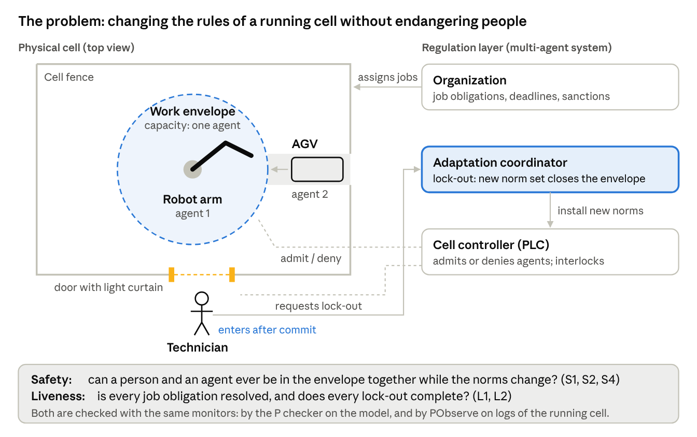

*Figure 1 · the problem: changing the rules of a running cell without endangering people*

The project operationalizes one cell of the conceptual grid proposed by [Yan, Nardin, Boissier & Sichman](https://hal-emse.ccsd.cnrs.fr/emse-05162306v1) (*A Unified View on Regulation Management in Multi-Agent Systems*, COINE 2025), turning a classification into a system whose properties can be checked mechanically. The grid is spanned by three perspectives: regulation capabilities, programming dimensions and architectural style. The cell considered here is **organization-centric and environment-centric, with a centralized architecture**.

**Research questions.** (i) Which regulation properties of a centralized, normative multi-agent manufacturing cell can be verified at design time, and which can only be monitored at run time? (ii) Under which interleavings of events does a straightforward implementation of regulation adaptation fail to preserve these properties?

**Working hypothesis.** A naive adaptation policy, in which the coordinator declares the new norm set and the controller installs it upon receipt, admits executions in which a maintenance technician enters an occupied work envelope. A two-phase policy (prepare, drain, commit) is expected to exclude such executions. The project tests this hypothesis for both policies and supports each conclusion with a counterexample trace from the checker or a violation report from PObserve.

**Learning outcomes.** Upon completion, students are expected to be able to:

- explain multi-agent systems, normative MAS and regulation management, and position a given design within the unified-view grid (LO1);
- formalize obligations, prohibitions, sanctions and regulation adaptation as communicating state machines in P (LO2);
- express safety and liveness properties as P specification monitors, interpret the counterexamples produced by `p check`, and justify the number of schedules on which a claim rests (LO3);
- compile the same monitors for PObserve, adapt and extend the provided log parser, and check execution logs against them, including logs with injected faults and defects (LO4);
- argue which properties are amenable to design-time verification and which require run-time monitoring (LO5);
- state the modeling assumptions on which each verification result depends, and the resulting threats to validity (LO6).

[Section 8](#8-work-plan-and-deliverables) relates each learning outcome to the activities and deliverables through which it is assessed.

## 2. Background: multi-agent systems

A multi-agent system (MAS) is a set of autonomous agents that share an environment and interact to achieve individual or collective goals. Because each agent decides autonomously, the global behavior of the system is not programmed directly but emerges from these interactions. This is the fundamental reason why such systems require regulation.

**Agents.** Following [Wooldridge](#references), an agent is a software or physical entity characterized by four properties:

- **autonomy**: it acts without direct external intervention;
- **reactivity**: it responds in a timely manner to changes in its environment;
- **pro-activeness**: it exhibits goal-directed behavior;
- **social ability**: it interacts with other agents through communication.

Most MAS platforms adopt the belief–desire–intention (BDI) model, in which agents reason over *beliefs*, *desires* (goals) and *intentions* (plans to which they have committed). Jason, an interpreter for the AgentSpeak language, is a representative example.

**Multi-Agent Oriented Programming (MAOP).** [Boissier et al.](#references) decompose a MAS into four programming dimensions, each with its own first-class abstractions. The JaCaMo platform combines one technology per dimension ([Figure 2](#figure-2)).

| Dimension | First-class abstractions | JaCaMo technology | Role in this project |
| --- | --- | --- | --- |
| Agent | beliefs, goals, plans | Jason | robot arm and AGV controllers |
| Environment | artifacts with operations and observable properties | CArtAgO | cell controller (PLC) admitting agents to the work envelope |
| Interaction | protocols, messages | Jason speech acts | access request / grant / deny protocol |
| Organization | roles, groups, missions, norms | Moise + NPL | job obligations, deadlines, sanctions, lock-out procedure |

<a id="figure-2"></a>

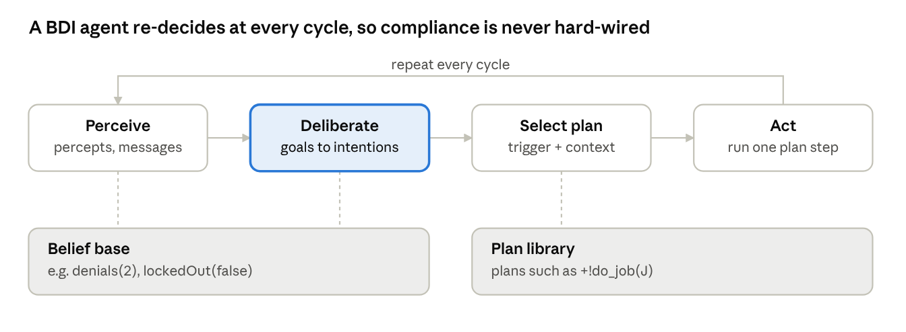

*Figure 2 · MAOP dimensions and JaCaMo technologies, with the cell's components*

The physical layer lies outside the MAS; the environment dimension is the interface through which the MAS acts upon it. For this reason, regimented safety norms are placed in the environment.

**Open systems.** In an open MAS the designer does not control the internal code of the agents, which may be supplied by different vendors or include learning components. Correctness therefore cannot depend on agent compliance: the regulation layer should preserve its guarantees under every behavior that agents can exhibit through the regulation interface (requests, releases and reports), whether or not they comply with the norms. [Section 7](#7-technical-specification) approximates this requirement by modeling agents nondeterministically within the interaction protocol; the behaviors that the model excludes, such as entering the envelope without a grant, are listed in [Section 7.7](#77-modeling-assumptions-and-threats-to-validity).

**MAS in industrial cyber-physical systems.** In Industry 4.0 architectures, machines, robots and transport units are encapsulated as agents that negotiate tasks and resources. A manufacturing cell thus becomes a small MAS whose shared physical resources (a work envelope, a buffer, a tool) must be regulated. Because some of its rules protect human operators, they must be enforced *physically*, not only at the logical level.

### 2.1 Agent architectures and the BDI cycle

Agent architectures are commonly classified into three families:

- **Reactive** agents map percepts directly to actions; they respond quickly but do not plan.
- **Deliberative** agents maintain a symbolic model of the world and reason about goals before acting.
- **Hybrid** agents layer a reactive component (e.g., a robot's collision stop) beneath a deliberative one (e.g., job sequencing).

Industrial agents are typically hybrid: a deliberative agent operates on top of a programmable logic controller (PLC) or robot controller that is responsible for real-time control. JaCaMo agents are deliberative at the task level.

A BDI agent executes the following **reasoning cycle** repeatedly ([Figure 3](#figure-3)):

1. **Perception.** Percepts (sensor readings, artifact properties) and incoming messages are read, and the *belief base* is updated accordingly.
2. **Deliberation.** The agent selects the goals it will pursue; the selected goals become *intentions*.
3. **Plan selection.** A plan is chosen from the plan library whose triggering event matches the goal and whose context condition holds in the current beliefs.
4. **Action.** One step of one intention is executed (an action, a message or a subgoal), after which the cycle restarts at step 1.

<a id="figure-3"></a>

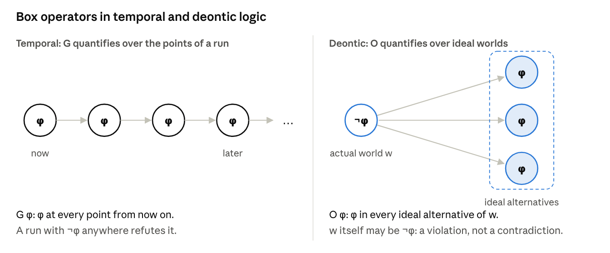

*Figure 3 · the BDI reasoning cycle*

A simplified version of the robot-arm agent in Jason (AgentSpeak) is shown below:

```
// plan: <trigger> : <context> <- <body>.
+!do_job(J) : true
   <- requestAccess;              // operation on the cell controller artifact; fails if denied
      !process(J);
      release;
      .send(org, tell, done(J)).    // the report that fulfils the obligation

// failure handling: after 3 denials give up the job (and accept the sanction)
-!do_job(J) : denials(N) & N >= 3
   <- .drop_intention(do_job(J)).
-!do_job(J)
   <- .wait(500); !do_job(J).
```

The agent *chooses* whether to retry, abandon the job or report it; this choice is the locus of its autonomy. The regulation layer can constrain the outcomes of such choices, but not the reasoning that produces them.

### 2.2 Environment: artifacts

In CArtAgO, the environment is composed of **artifacts**: objects that agents use in the manner of tools. An artifact provides:

- **operations**: actions that agents can perform on it;
- **observable properties**: state that agents perceive as beliefs;
- **signals**: transient events.

Because an operation may refuse to execute, artifacts are the natural locus of *regimentation*: an attempt to perform a prohibited action fails.

```java
// The cell controller as a CArtAgO artifact (sketch)
public class CellController extends Artifact {
  private int capacity;

  void init(int capacity) {
    this.capacity = capacity;
    defineObsProperty("occupancy", 0);
    defineObsProperty("lockedOut", false);    // set by the norm set in force
  }

  @OPERATION void requestAccess() {
    ObsProperty occ = getObsProperty("occupancy");
    if (getObsProperty("lockedOut").booleanValue() || occ.intValue() >= capacity) {
      failed("access denied");                  // regimentation: the action fails
    } else {
      occ.updateValue(occ.intValue() + 1);
    }
  }

  @OPERATION void release() {
    ObsProperty occ = getObsProperty("occupancy");
    occ.updateValue(occ.intValue() - 1);
  }
}
```

In a physical cell, the artifact wraps the PLC, typically through OPC UA, and the PLC actuates the interlocks. The `ResourceGuard` machine described in [Section 7](#7-technical-specification) is the P model of this artifact.

### 2.3 Interaction

Agents communicate through an agent communication language such as KQML or FIPA ACL. Each message carries a **performative** that states its communicative intent, for instance *inform*, *request*, *propose*, *accept* or *refuse*. In Jason, `.send(org, tell, done(j7))` informs the recipient of a fact, whereas `.send(agv, achieve, unload)` delegates a goal.

Recurring patterns of message exchange are fixed as **protocols**. The **Contract Net** protocol is the classical mechanism for task allocation: the organization announces a job, the arm and the AGV submit bids (e.g., based on availability), and the job is awarded to one bidder. Approaches based on social commitments (Singh) assign a normative meaning to protocol steps (*"having accepted the job, the agent is committed to completing it"*), thereby linking interaction to the norms discussed in [Section 3](#3-background-norms-and-normative-mas).

### 2.4 Organization: Moise

Moise describes an organization by means of three interrelated specifications:

| Specification | Describes | Cell example |
| --- | --- | --- |
| Structural | roles, groups, links between roles, cardinalities | group `cell_A` with role `operator_robot` (max 2) and role `cell_supervisor` (1) |
| Functional | global goals decomposed into **schemes** and **missions** | scheme `job`: goals `load`, `process`, `unload`, `report`; mission `m_job` covers them |
| Normative | obligations and permissions linking roles to missions, with deadlines | *an `operator_robot` is obliged to commit to `m_job` and achieve it within 4 ticks* |

A simplified normative specification is shown below:

```xml
<normative-specification>
  <norm id="n_job" type="obligation" role="operator_robot"
        mission="m_job" time-constraint="4 minutes"/>
</normative-specification>
```

Moise and NPL express deadlines in physical time (here, 4 minutes). The P model and the logs of this project express them in logical ticks of the organization's clock, where one tick corresponds to a configurable period; [Section 3.4](#34-norms-as-temporal-properties) defines the convention.

At run time, the organization is itself represented as an artifact. Agents adopt roles and commit to missions, and the organization's normative engine (NPL, [Section 3](#3-background-norms-and-normative-mas)) creates and tracks the resulting obligations.

### 2.5 Agents in manufacturing

Agent-based manufacturing has a long research history, and its reference architectures constrain where regulation can be placed:

- **Holonic manufacturing.** PROSA (Van Brussel et al., 1998) decomposes a plant into product, resource and order holons, complemented by optional staff holons with an advisory role. ADACOR (Leitão and Restivo) adds adaptive switching between hierarchical and decentralized control.
- **Agents above automation.** Agents operate above the real-time control layer (PLCs, IEC 61131 or IEC 61499 function blocks) and communicate with it through OPC UA. Hard real-time and safety functions remain in that layer.
- **Safety regulations.** Robot safety standards (ISO 10218) and lock-out/tag-out procedures (e.g., OSHA 29 CFR 1910.147) determine the conditions under which people may enter a robot cell. The lock-out studied in this project is the normative-MAS counterpart of such a procedure.

The last point sets the standard for the project. A lock-out that is respected only in most executions is not acceptable: either the regulation guarantees it, or the design identifies the lower layer (an emergency stop or a door interlock) that provides the guarantee.

## 3. Background: norms and normative MAS

Norms allow a MAS to regulate the behavior of autonomous agents without programming their internal decision-making. They specify what *ought* to happen and what follows when it does not. A **normative MAS** is a MAS whose behavior is constrained by explicitly represented norms, which agents can reason about and the system can monitor and enforce ([Boella, van der Torre and Verhagen](#references)).

**Deontic modalities.** A regulative norm typically takes one of three forms:

- **Obligation** O(φ): the addressee must bring about φ, typically before a deadline; e.g., *"the agent assigned job j must report completion before tick d."*
- **Prohibition** F(φ): the addressee must not bring about φ; e.g., *"no agent may be in the envelope while a person is inside."*
- **Permission** P(φ): φ is allowed, often as an exception to a prohibition.

Norms are usually *conditional*: they comprise an activation condition, a deontic content, a deadline or expiry condition, and a sanction. Their lifecycle proceeds from inactive to active, and from active either to fulfilled or to violated and subsequently sanctioned.

**Regulative and constitutive norms.** Regulative norms constrain behavior ("must", "must not"). Constitutive norms define what things *count as* within the institution; e.g., *"a badge swipe at door D counts as the technician entering the cell."* The adaptation model adopted in this project relies on both kinds ([Section 4](#4-background-regulation-management-in-mas)).

**Enforcement mechanisms.** A norm can be enforced in two ways:

| Mechanism | Idea | Guarantee | Cost | In this project |
| --- | --- | --- | --- | --- |
| Regimentation | make the violation impossible: the environment refuses the action | the norm always holds | removes autonomy; only for actions the environment controls | the cell controller refuses admission to a closed or full envelope |
| Sanctioning (regulation) | allow the violation, detect it, react with a sanction | holds only as far as sanctions deter | needs monitoring and a fair sanction policy | a missed job deadline leads to a sanction |

Safety-critical norms in a CPS, where people and machines share the same space, must be regimented, whereas performance norms such as deadlines are normally sanctioned. [Alechina, Bulling, Dastani and Logan (AAMAS 2015)](https://nottingham-repository.worktribe.com/output/752739) show that not every norm can be enforced by a guard; the choice between the two mechanisms is therefore a substantive design decision.

**Norms in JaCaMo.** Moise organizations are compiled into programs of the Normative Programming Language (NPL). An NPL engine creates obligations when agents adopt roles and commit to missions, tracks their deadlines, and reports violations to the organization.

**Verification of norms.** Previous work has applied model checking to normative systems, for example:

- ORWELL + MCAPL ([Dennis et al.](https://personalpages.manchester.ac.uk/staff/louise.dennis/pubs/climaX.pdf))
- CÒIR in Maude ([Gasparini et al.](https://abdn.elsevierpure.com/en/publications/c%C3%B2ir-verifying-normative-specifications-of-complex-systems))
- norm enforcement as supervisory control ([Dastani, Sardina and Yazdanpanah](https://research.utwente.nl/en/publications/norm-enforcement-as-supervisory-control/))

These approaches primarily verify a normative *specification*. The present project instead verifies the *regulation machinery*: the concurrent components that monitor, enforce and modify the norms.

### 3.1 Anatomy of a norm

A conditional norm can be represented as a tuple of six components. The job obligation of the cell decomposes as follows:

| Part | Meaning | Cell example |
| --- | --- | --- |
| Addressee | who the norm binds (an agent or a role) | the agent playing `operator_robot` that accepted job j |
| Activation | when an instance of the norm starts | the organization assigns j |
| Modality | obligation, prohibition or permission | obligation |
| Content | the state or action concerned | j is reported as done |
| Deadline | when the content must hold | 4 ticks after assignment in the simulated logs; an absolute tick (4 for the arm, 6 for the AGV) in the starter model |
| Sanction | what follows a violation (or reward for compliance) | lower priority in the next job allocation |

The norm is a template: each job assignment creates a new **norm instance** with its own deadline. The `ObligationManager` described in [Section 7](#7-technical-specification) maintains one record per instance.

### 3.2 Deontic logic in brief

Standard deontic logic (SDL) is a modal logic with the operators O (obligatory), P (permitted) and F (forbidden). The operators are interdefinable, and axiom D states that an obligation implies a permission, so that no agent is obliged to bring about a logical impossibility (O ⊥ is excluded):

```latex
P(\varphi) \equiv \neg O(\neg\varphi) \qquad F(\varphi) \equiv O(\neg\varphi) \qquad O(\varphi) \rightarrow P(\varphi)
```

SDL has well-known limitations. The most prominent concerns **contrary-to-duty** reasoning, i.e., what is obligatory *after* a violation has occurred; e.g., *"no agent may move in the envelope during a lock-out; if one does, the cell must trigger the e-stop."* Chisholm's paradox demonstrates that SDL cannot represent such norms adequately.

For this reason, normative MAS commonly treat norms *operationally*, as objects with a lifecycle ([Section 3.3](#33-lifecycle-of-a-norm-instance)) that are evaluated against the observed behavior of the system. P models norms in the same manner.

#### Deontic logic seen from temporal logic

For those who already know temporal logic, such as CTL and LTL, the intuition behind deontic logic is similar. All three are *normal modal logics*: each has a box operator, its dual diamond operator, and a semantics given by Kripke structures. In each, the box distributes over implication (axiom K), and every theorem may be prefixed with a box (necessitation rule). The logics differ in the interpretation of the accessibility relation ([Figure 4](#figure-4)). In temporal logic, the relation connects a point of a run to its successors; in deontic logic, it connects a world to its *ideal alternatives*, i.e., the worlds in which every norm is respected.

<a id="figure-4"></a>

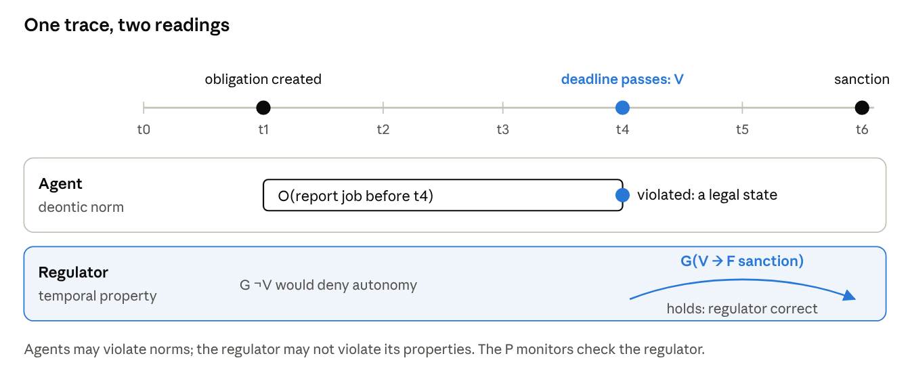

*Figure 4 · the box of temporal logic and the box of deontic logic*

|  | Temporal logic (LTL / CTL) | Deontic logic (SDL) |
| --- | --- | --- |
| Box | G φ: φ holds at every future point (AG: on every run) | O φ: φ holds in every ideal world |
| Diamond | F φ = ¬G¬φ: φ holds at some future point | P φ = ¬O¬φ: φ holds in some ideal world |
| Box of a negation | G ¬φ: φ never holds | Forb φ = O ¬φ: φ is forbidden |
| Accessibility relation | "later than", along a run | "ideal alternative of" |
| Characteristic axiom | T (reflexivity): G φ → φ | D (seriality): O φ → P φ |
| Consequence of ¬φ in the current state | G φ is false; the run is a counterexample | no inconsistency: O φ ∧ ¬φ is satisfiable |

A note on notation: F denotes *eventually* in temporal logic and *forbidden* in deontic logic. Where both logics appear together, as in the preceding table and in the remainder of this subsection, the deontic operator is written Forb.

The last two rows capture the essential difference. G is reflexive: if φ holds at every point, it holds at the present one, so a single state satisfying ¬φ refutes G φ. O is *not* reflexive: the ideal worlds need not include the actual world, so "the job ought to be reported" and "the job was not reported" may both be true. This is the property a normative system requires: a violation is neither a contradiction nor a defect of the specification, but a state that the system must be able to represent and to which it must react. Axiom D requires only that every world have at least one ideal alternative; it thereby excludes jointly unsatisfiable obligations, such as O φ ∧ O ¬φ or O ⊥. It does not exclude obligations that are logically consistent but cannot be discharged in practice.

**Ought implies can.** Axiom D concerns *logical* possibility. A different principle, traditionally attributed to Kant and summarized as *ought implies can*, concerns *practical* possibility: an agent should be obliged only to what it is able to do. Standard deontic logic has no notion of ability and therefore cannot express this principle. The distinction is relevant to the cell: an agent that is denied access to the envelope during a lock-out may be unable to complete its job before the deadline, although its obligation is logically consistent. Sanctioning such an agent satisfies every axiom of SDL but contradicts the requirement that sanctions penalize only avoidable conduct ([Section 3.7](#37-sanctions)). Checking the principle requires information about ability, in this case about the denials issued by the regulation, which experiment E7 adds to the model.

#### From "ought" to "happens": the Andersonian reduction

[Anderson (1958)](https://doi.org/10.1093/mind/LXVII.265.100) showed that deontic logic can be reduced to an ordinary (alethic) modal logic extended with a single propositional constant V, interpreted as "a violation has occurred":

```latex
O\varphi \equiv \Box(\neg\varphi \rightarrow V) \qquad
P\varphi \equiv \Diamond(\varphi \wedge \neg V) \qquad
\mathit{Forb}\,\varphi \equiv \Box(\varphi \rightarrow V)
```

[Meyer (1988)](https://doi.org/10.1305/ndjfl/1093637776) applied the same idea to actions in the framework of dynamic logic: an action α is forbidden if every execution of α leads to a violation, \[α\]V, and permitted if some execution of α does not, ⟨α⟩¬V.

This reduction provides the conceptual basis for the approach adopted in this project. If violations are treated as observable events and the box is interpreted temporally, each norm becomes an ordinary temporal property *about violations*. The monitors of [Section 7.2](#72-property-catalogue), whose temporal forms are given in [Section 3.4](#34-norms-as-temporal-properties), are constructed in this way: none of them employs a deontic operator, and each refers to fulfillment, violation or sanction events.

#### One trace, two readings

The reduction also clarifies *whose* behavior is being specified ([Figure 5](#figure-5)).

<a id="figure-5"></a>


*Figure 5 · one trace read deontically (agents) and temporally (regulator)*

- **For the agents, norms are deontic.** An agent may miss a deadline; the specification must therefore not reject such a trace, but must determine its consequences. Requiring G ¬V would be a modeling error: it would convert every norm into a regimented constraint and thereby eliminate the autonomy that characterizes an open MAS.
- **For the regulator, properties are temporal.** The regulator must sanction every violation exactly once, must never admit an agent that the norm set prohibits, and must complete every adaptation. These are G and F properties that must hold on every run; a run that violates them exposes a defect in the regulator.

Consequently, the P monitors never assert that agents behave correctly. They assert that the *regulation* behaves correctly irrespective of agent behavior: S1 and S2 for regimented norms, where the regulator is able to block actions; R3 for the lock-out procedure, which can only be monitored; S3 for the integrity of the organization's records; L1 and R1 for sanctioned norms, where the regulator must react to violations; and L2 and R2 for the adaptation itself. [Section 7.6](#76-traceability) gives the complete classification.

#### Kinds of norms as temporal patterns

Once violations are represented as events, each kind of norm corresponds to a characteristic temporal pattern. The following table illustrates these patterns with the norms of the cell.

| Kind of norm | Example in the cell | Violation V occurs when | What the regulator must guarantee |
| --- | --- | --- | --- |
| Achievement obligation with a deadline | report the job by tick d | tick d passes without a report | G(created → F(fulfilled ∨ sanctioned)), L1; bounded at run time, R1 |
| Maintenance obligation | keep the envelope empty while it is locked out | an agent is admitted while it is closed | regimented: G(closed → ¬admitted), S2 |
| Prohibition | no agent in the envelope with a person | both are inside | regimented: G ¬(agent inside ∧ person inside), S1 |
| Contrary-to-duty obligation | if an agent is inside during a lock-out, trigger the e-stop | the prohibition above is violated | G(V → e-stop before any further admission): a bounded response on the *reaction*; not implemented in the starter kit |
| Permission | an agent may enter an open, empty envelope | never: a permission cannot be violated | AG(request ∧ open ∧ empty → EF granted): branching, not a trace property |

Two rows of the table require further explanation.

- **Contrary-to-duty norms become straightforward to express.** Chisholm's paradox arises in SDL because the logic has neither a notion of time nor an explicit representation of violations. When V is an event, the secondary obligation is triggered by that event. Temporal deontic logics with deadlines avoid the paradox in the same manner. The *next* operator X is deliberately not used: in an asynchronous interleaving model, the step that follows a violation may belong to any machine, so the reaction is specified as a bounded response (the e-stop occurs before any further admission, or within k ticks). The starter kit does not implement this reaction; it is an optional extension.
- **Permission is not a trace property.** The statement "an agent *may* enter" asserts that some admissible continuation allows the agent to enter. A single run in which the agent did not enter is therefore not evidence of a violation, since the agent may have chosen not to enter. In CTL, permission corresponds to an EF property quantified over all possible futures, which neither a single-trace monitor nor PObserve can check. The P checker can check only the liveness property "every request for an open, empty resource is eventually granted" (AF instead of EF). This approximation is *stronger* than the permission: if it holds, the permission is witnessed; if it fails, nothing follows about the permission. In the cell, the approximation is expected to fail even though the permission holds, because the capacity is one and agents abandon a job after three denials. The report should state which of the cell's norms correspond to safety, liveness or branching properties.

#### Two further paradoxes

- **Ross's paradox.** From O(report the job), SDL derives O(report the job ∨ delete the log), because the box operator is closed under logical consequence. In LTL, the analogous inference G φ → G(φ ∨ ψ) is innocuous; for obligations, however, it is counterintuitive, since deleting the log would appear to discharge the duty.
- **Free-choice permission.** The statement "an agent may use cell A or cell B" should intuitively entail "an agent may use cell A", yet P(φ ∨ ψ) → P φ is not valid in SDL.

These paradoxes motivate the decision to specify norms *operationally*, as machines that create, fulfill and violate norm instances, and to verify them with temporal monitors rather than by reasoning in SDL. The [Stanford Encyclopedia of Philosophy entry on deontic logic](https://plato.stanford.edu/entries/logic-deontic/) provides a broader survey.

### 3.3 Lifecycle of a norm instance

Each norm instance evolves according to a small state machine. The monitors defined in [Section 7](#7-technical-specification) observe its transitions through the P events indicated beneath each state ([Figure 6](#figure-6)).

<a id="figure-6"></a>

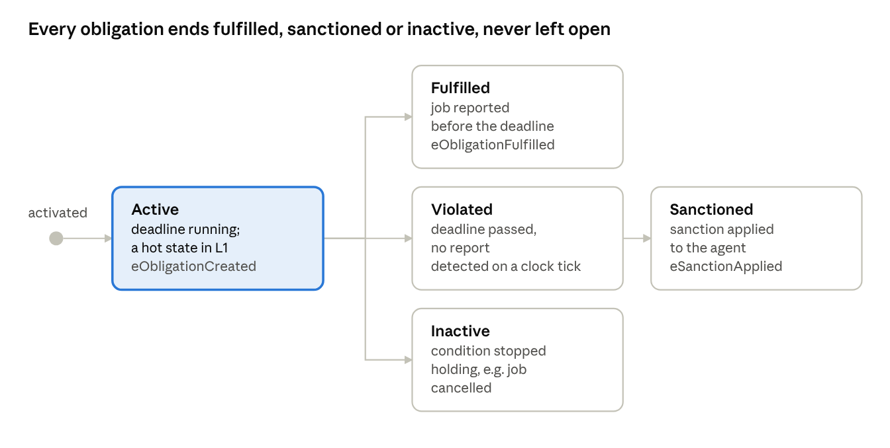

*Figure 6 · lifecycle of an obligation instance, with the P events that mark each state*

An instance that remains in **Active** indefinitely constitutes the failure detected by liveness property L1. An instance that reaches both **Fulfilled** and **Sanctioned** is excluded by safety property S3.

**Race between report and deadline.** A report and the tick that passes the deadline are independent events and may be processed in either order. In the starter kit, the obligation manager records whichever outcome it processes first and ignores a report that arrives after the sanction; S3 guarantees only that an instance never receives both outcomes. A job completed shortly before its deadline may therefore be sanctioned. Whether a late report should cancel or mitigate the sanction is a design question to be addressed in the report.

### 3.4 Norms as temporal properties

To verify norms with a model checker, each kind of norm is expressed as a temporal-logic property (G denotes *always*, F denotes *eventually*). The class of the resulting property determines how it is checked in P:

| Norm kind | Temporal property | Property class | P construct | Checked at run time? |
| --- | --- | --- | --- | --- |
| Prohibition: *never an agent and a person in the envelope* | G ¬(agentIn ∧ personIn) | safety | `assert` in a spec | yes (PObserve) |
| Obligation without deadline: *every job is eventually resolved* | G(assigned → F resolved) | liveness | `hot` state in a spec | no: no finite log can refute it; a clean log is inconclusive |
| Obligation with deadline d (in ticks) | G(assigned(d) → resolved no later than tick d + 1) | bounded response (a safety property over time) | `assert` when tick d + 2 arrives | yes (PObserve) |
| Permission: *an agent may enter an open, empty envelope* | AG(request ∧ open ∧ empty → EF granted) | branching (CTL), not a trace property | no direct construct; only the stronger liveness approximation of [Section 3.2](#32-deontic-logic-in-brief) | no |

In an open system, the regulation cannot guarantee that every obligation is *fulfilled*; it can guarantee only that every obligation is *resolved*, either by fulfillment or by sanction. The property to be checked is therefore:

```latex
\mathbf{G}\big(\mathit{assigned}(a,j,d) \rightarrow \mathbf{F}\,(\mathit{resolved}(a,j) \wedge \mathit{now} \le d+1)\big), \qquad \mathit{resolved} \equiv \mathit{reported} \lor \mathit{sanctioned}
```

**Deadline convention.** Deadlines are expressed in ticks of the organization's logical clock. The grace of one tick reflects the implementation: the obligation manager checks deadlines when a tick arrives and sanctions at the first tick with now > d, so an obligation due at tick d is resolved at tick d + 1 at the latest, and R1 reports a violation only when tick d + 2 arrives (INSTRUCTIONS §3.9). In the starter model, d is an absolute tick (4 for the arm and 6 for the AGV); in the simulated logs, d is the assignment tick plus 4. Experiment E5 varies d.

**Finite traces and three-valued verdicts.** LTL is defined over infinite runs, whereas a log is finite. Runtime verification therefore assigns one of three verdicts to a finite prefix ([Bauer, Leucker and Schallhart](https://doi.org/10.1145/2000799.2000800)): *violated* if every infinite continuation of the prefix violates the property, *satisfied* if every continuation satisfies it, and *inconclusive* otherwise. A property is *monitorable* if every prefix can be extended to a prefix with a conclusive verdict. Safety properties such as S1 can be refuted by a finite prefix but never confirmed by one, whereas G(assigned → F resolved) can be neither refuted nor confirmed by any finite prefix; this is why L1 is replaced by the bounded response R1 at run time. Consequently, a PObserve run without violations establishes only that no bad prefix occurred in the logged execution. For a bounded property whose deadline lies beyond the end of the log, and for any log that stops early, the correct verdict is *inconclusive*, not *holds*.

#### Worked example: from a norm to a monitor

The construction of L1 illustrates how a norm becomes a P monitor in four steps.

1. **Norm.** *Every job assigned to an agent ends either with a report or with a sanction.*
2. **Temporal property.** G(created(o) → F resolved(o)) for every obligation identifier o, where resolved(o) ≡ fulfilled(o) ∨ sanctioned(o). Because the property is parameterized by o, the monitor maintains the set of pending identifiers rather than a single proposition.
3. **Automaton.** The property corresponds to the two-state automaton of [Figure 7](#figure-7). The cold state `NoneOpen` means that no obligation is pending; the hot state `SomeOpen` means that at least one obligation still awaits an outcome.
4. **P monitor.** The automaton is written as a `spec` machine whose cold and hot states mirror [Figure 7](#figure-7) (file `Common/Specs.p`).

<a id="figure-7"></a>

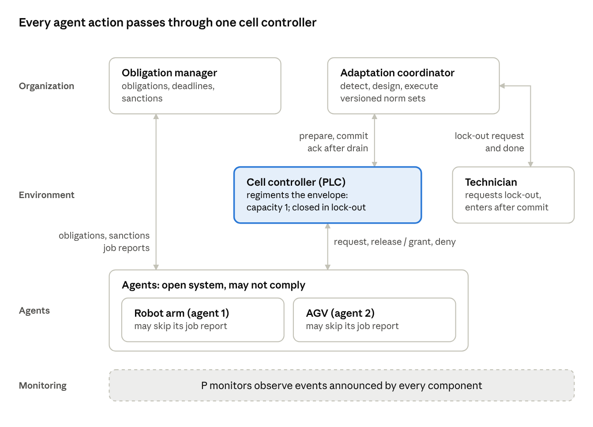

*Figure 7 · monitor automaton for the liveness property L1, with its cold and hot states*

```
spec EveryObligationResolved observes eObligationCreated, eObligationFulfilled, eSanctionApplied {
  var pending: set[int];
  start cold state NoneOpen {
    on eObligationCreated do (o: tObligation) { pending += (o.id); goto SomeOpen; }
    on eObligationFulfilled, eSanctionApplied do (o: tOutcome) {
      assert false, format("outcome for unknown obligation {0}", o.id);
    }
  }
  hot state SomeOpen {
    on eObligationCreated do (o: tObligation) { pending += (o.id); }
    on eObligationFulfilled, eSanctionApplied do (o: tOutcome) {
      if (o.id in pending) { pending -= (o.id); }
      if (sizeof(pending) == 0) { goto NoneOpen; }
    }
  }
}
```

Not every temporal formula maps as directly. Safety formulas such as G p or G(p → q), evaluated over the variables of the monitor, map to `assert` statements; response formulas G(p → F q) map to a hot state that is entered on p and left on q; formulas with nested temporal operators require auxiliary monitor variables or additional states; and branching formulas such as EF have no counterpart. P monitors are, moreover, *event-based*: a proposition such as agentIn is not observed directly but is reconstructed by the monitor from entry and exit events, which is itself a modeling decision ([Section 3.6](#36-constitutive-rules-situated-artificial-institutions)).

### 3.5 Normative programming in JaCaMo: NPL

The Normative Programming Language (NPL) of Hübner, Boissier and Bordini expresses norms as rules, each consisting of an activation condition and a deontic consequence with a deadline. A simplified NPL-style rule for the job obligation is shown below:

```
norm n_job:
     play(A, operator_robot, cell_A) & assigned(A, J)
  -> obligation(A, n_job, done(J), `now` + `4 minutes`).
```

The NPL engine maintains each obligation instance in one of four states:

- **active**: the condition holds and the deadline has not been reached;
- **fulfilled**: the content was achieved before the deadline;
- **unfulfilled**: the deadline elapsed without fulfillment, i.e., the obligation was violated;
- **inactive**: the activation condition ceased to hold.

The organization typically reacts to unfulfilled obligations by applying a sanction. [Yan et al.](https://hal-lara.archives-ouvertes.fr/ISCOD-ENSMSE/hal-05350751v1) extend NPL(s) and the SAI engine to support regulation adaptation ([Section 4](#4-background-regulation-management-in-mas)).

### 3.6 Constitutive rules: Situated Artificial Institutions

Norms refer to *institutional* facts ("the technician is in the cell", "the arm has entered the envelope"), whereas the system observes *physical* facts ("the light curtain is interrupted", "badge 0412 was swiped at door D"). **Constitutive rules** relate the two. In Situated Artificial Institutions (SAI; de Brito, Hübner and Boissier), they take the form *X count-as Y when C*:

- *badge swipe at door D* **count-as** *the technician entering the cell*, **when** *a lock-out is committed*
- *a lock-out request from an agent playing `maintenance`* **count-as** *a detect-fact for closing the cell*

This relation is significant for verification: if a count-as rule is incorrect, the regulation operates on incorrect facts even when every other component behaves correctly. In this project, the count-as layer appears in two places:

- in the model, where the `announce` statements determine which events count as institutional facts;
- at run time, in the PObserve **log parser**, which maps log lines to those facts.

The parser is therefore among the components that must be validated.

### 3.7 Sanctions

Sanctions may take several forms:

- **material**: the loss of a reward, or a penalty in a cost model;
- **reputational**: a reduction of a trust score;
- **access-based**: a lower priority in job allocation, or a mandatory health check before the next job.

Sanctions may be applied by the organization, by peers or by the environment. Sanction policies should be *proportional* and *fair*, penalizing only conduct that the agent could have avoided. In the cell, an agent denied access during a lock-out may miss its deadline through no fault of its own; whether such an agent should be sanctioned is a design decision that the report must discuss. The question is an instance of the principle "ought implies can" ([Section 3.2](#32-deontic-logic-in-brief)); experiment E7 provides evidence for it.

### 3.8 Choosing an enforcement mechanism

The appropriate enforcement mechanism for a norm depends on two factors: the cost of a single violation, and whether the environment can physically block the forbidden action. [Figure 8](#figure-8) positions the norms of the cell along these two dimensions.

<a id="figure-8"></a>

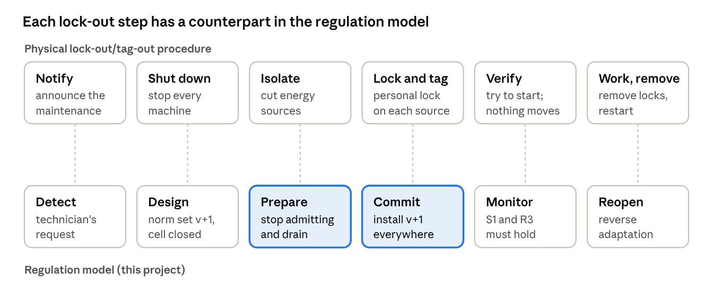

*Figure 8 · the norms of the cell placed by cost and controllability*

- **High cost, blockable: regimentation.** The cell controller can refuse entry, and a single collision or injury is unacceptable. The capacity norm and the norm "no agent together with a person" are therefore regimented.
- **High cost, not blockable: monitoring complemented by a safety layer.** The multi-agent system cannot prevent a person from opening the door. Compliance with the lock-out procedure can only be monitored (property R3); the actual guarantee must therefore be provided by a layer below the MAS, such as a door interlock or an emergency stop.
- **Low cost, not blockable: sanctioning.** A late job report affects throughput, not safety; in this case, preserving agent autonomy outweighs the benefit of strict control.
- **Low cost, blockable: a design decision.** Regimentation is feasible but may reduce flexibility for a limited gain.

The figure also indicates where verification is most critical. A regimented norm must hold in every interleaving of events, which is the space the P checker explores. A sanctioned norm need only be resolved, by fulfillment or by sanction, which is a liveness property.

## 4. Background: regulation management in MAS

Regulation management concerns the balance between agent autonomy and system-level control. It comprises the representation, monitoring, enforcement and run-time modification of regulations. [Yan, Nardin, Boissier and Sichman](https://hal-emse.ccsd.cnrs.fr/emse-05162306v1) propose a **unified view** that positions any design along three perspectives, and they use the resulting grid to classify existing MAS frameworks. [Figure 9](#figure-9) places the cell in this grid.

| Perspective | Options | This project (cell) |
| --- | --- | --- |
| Regulation capabilities | what the regulation layer can do; operationalized here as *represent, monitor, enforce (regiment or sanction), adapt* | all four |
| MAOP dimension | agent-, environment-, interaction-, organization-centric, or hybrid (several at once) | organization-centric (obligations, adaptation) + environment-centric (the cell controller) |
| Architectural style | centralized vs. decentralized / distributed regulators | **centralized**: one cell controller, one organizational engine |

<a id="figure-9"></a>

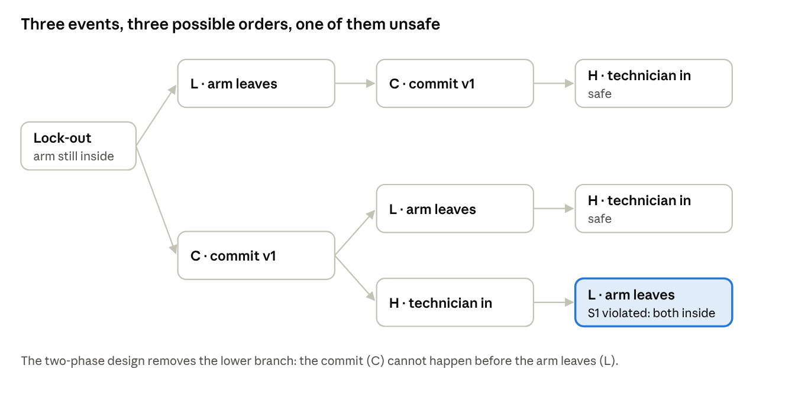

*Figure 9 · the cell placed in the unified-view grid*

The COINE 2025 paper is not openly deposited. During the first week, the exact list of capabilities given in the paper is to be verified and the mapping in [Section 7](#7-technical-specification) adjusted accordingly.

**Regulation adaptation.** Regulations change at run time, for instance when a technician requires access to the cell, when a shift changes, or when a sensor fails. [Yan et al. (ECAI 2025)](https://hal-lara.archives-ouvertes.fr/ISCOD-ENSMSE/hal-05350751v1) propose a general adaptation model comprising three capabilities, each of which produces a fact:

1. **Detect**: recognition of a change that requires new regulation (a *detect-fact*).
2. **Design**: elaboration of the new regulation (a *design-fact*).
3. **Execute**: installation of the new regulation in the running system (an *execute-fact*).

Constitutive and regulative norms determine who may perform each step and under which conditions. The authors implement the model by extending the SAI and NPL(s) normative engines within JaCaMo. A companion paper ([WESAAC 2025](https://sol.sbc.org.br/index.php/wesaac/article/view/37527)) discusses, by means of a manufacturing case study, where adaptation can be located along the MAOP dimensions.

**Research gap addressed by this project.** The unified view is a *classification*: it indicates where regulation is located, not whether a given design is correct. Two components that are individually correct may nevertheless interact incorrectly. For example, an adaptation coordinator and a cell controller exchange messages asynchronously, so that during a transient interval they may disagree on which norms are in force. In the cell, this interval corresponds to the period during which a person and a robot may share the envelope. Detecting such intervals requires a tool that explores message interleavings, as discussed in [Section 5](#5-background-the-p-language-and-pobserve).

### 4.1 The capabilities in detail

Each capability addresses a specific design question, and two designs may realize the same capability in substantially different ways.

| Capability | Question it answers | Design options | In this cell |
| --- | --- | --- | --- |
| Represent | Where and how are the norms written down? | implicit in agent or controller code; explicit declarative norms (NPL); versioned norm sets | a versioned norm set (is the envelope locked out?), plus job obligations in the organization |
| Monitor | Who observes what, and is it enough to detect a violation? | agents monitor themselves; artifacts observe actions on them; the organization collects reports | the cell controller observes entries and exits; the door switch observes people; the organization observes reports and the clock |
| Enforce | What happens to a violation? | regimentation (it cannot happen) or sanctioning (it is detected and punished) | regimented capacity and lock-out; sanctioned deadlines |
| Adapt | How do the norms change at run time, and who may change them? | detect, design and execute steps, each run by an agent, an artifact or the organization | the technician detects; the coordinator designs and executes; the cell controller installs |

**Observability.** A norm can be monitored only if its content is observable. The norm *"no agent in the envelope together with a person"* requires observation of both envelope occupancy and human presence. If the light curtain fails, the regulation can no longer detect the technician and ceases to protect them without any indication of failure. Run-time monitoring with PObserve evaluates what the logs record and therefore is subject to the same observability limitations.

### 4.2 The MAOP views, with examples

The unified view locates regulation along the four MAOP dimensions. The examples below are typical systems for each view; they reflect the interpretation adopted in this specification rather than the classification given in the paper, which is to be verified during the first week.

| View | Regulation is represented and managed by… | Typical mechanism | Strength | Weakness |
| --- | --- | --- | --- | --- |
| Agent-centric | the agents themselves | norm-aware BDI agents that reason about obligations and choose to comply | full autonomy; no central component | relies on agents being honest and correct |
| Environment-centric | artifacts in the environment | CArtAgO artifacts or PLC interlocks that refuse forbidden actions | strong guarantees (regimentation) | only for actions that pass through an artifact |
| Interaction-centric | the protocols agents use to communicate | electronic institutions whose governors filter messages; commitment protocols | detects violations in communication | blind to physical actions |
| Organization-centric | an organizational infrastructure | Moise roles and missions with an NPL engine | explicit, inspectable norms | needs reliable reports from agents and environment |
| Hybrid | several of the above together | e.g. organization for obligations + environment for safety | each norm enforced where it is cheapest and strongest | the parts must stay consistent with each other |

The cell combines two views: safety norms reside in the environment (the cell controller), and performance norms reside in the organization (job obligations). The lock-out lies at the intersection of the two, since the organization decides and the environment enforces.

### 4.3 Architectural styles

| Style | Structure | Advantages | Risks |
| --- | --- | --- | --- |
| Centralized | one regulator for the whole system | one consistent view; simple to verify | bottleneck and single point of failure; does not scale to large plants |
| Hierarchical | regulators per area under a supervisor | local decisions with global oversight | the supervisor still observes changes with a delay |
| Distributed | several peer regulators, each owning part of the system | scales; local, fast decisions; no single point of failure | regulators can disagree during a change; needs a coordination protocol |

A single cell is naturally centralized, since one controller governs the envelope. Nevertheless, the regulator is divided into two components, the coordinator (organization) and the controller (environment), and the messages exchanged between them reproduce, on a small scale, the consistency problem of distributed systems.

### 4.4 Adaptation as a control loop

The detect–design–execute model of [Yan et al.](https://hal-lara.archives-ouvertes.fr/ISCOD-ENSMSE/hal-05350751v1) resembles the **MAPE-K loop** of autonomic computing (Kephart and Chess, 2003), which comprises the activities Monitor, Analyze, Plan and Execute, operating over shared Knowledge:

| MAPE-K step | Adaptation capability | Cell example |
| --- | --- | --- |
| Monitor + Analyze | detect | the technician's request is recognized as a need for a lock-out |
| Plan | design | the coordinator computes norm set v + 1 with the envelope closed |
| Execute | execute | the cell controller installs v + 1 |
| Knowledge | the norm sets and the organization's state | current version, lock-out status, open obligations |

One difference is significant: in a normative MAS, the adaptation loop is **itself regulated**. Constitutive norms determine which facts count as a valid trigger, and regulative norms determine who may perform each step; e.g., *only an agent playing `maintenance` or `safety_officer` may request a lock-out*. An unauthorized request therefore constitutes a violation in its own right.

### 4.5 Consistency during a regulation change

The **transition window** is the interval between the decision to change the norms and the moment at which the controller applies the change. Three hazards arise within this window:

1. **Stale admission.** The controller, still operating on the previous norm set, admits an agent after the lock-out has been declared (property S2).
2. **Premature entry.** The technician enters before the envelope has been emptied (properties S1 and R3).
3. **Lost, reordered or conflicting update.** Two adaptations overlap; e.g., a second technician requests a lock-out while the first lock-out is in force. The coordinator serializes adaptations and numbers the norm sets, so updates are installed one at a time and in version order (property S2). Serialization does not, however, record *who* holds a lock-out. When the first technician leaves and requests reopening, the next norm set reopens the envelope although the second technician is still inside ([Figure 10](#figure-10)). Preventing this hazard requires additional state, the set of lock-out holders per resource, and an additional property, S4: no committed norm set reopens a resource while a person is inside. Experiment E4 reproduces the hazard.

<a id="figure-10"></a>


*Figure 10 · two technicians: serialized adaptations reopen an occupied envelope*

The remedy adopted here is a **prepare–drain–commit** protocol. It borrows the two phases of two-phase commit (2PC) from distributed databases, prepare and commit, but it is not 2PC in the classical sense: each resource has a single participant, no participant can vote *no*, and there is no abort path. Its closest conceptual relative is quiescence-based safe reconfiguration ([Kramer and Magee](https://doi.org/10.1109/32.60317)), in which a component is changed only after it has been driven into a quiescent state; here, the envelope is drained before the new norm set takes effect. The protocol consequently blocks under different conditions than 2PC. Classical 2PC blocks when the coordinator fails after the participants have prepared, leaving them uncertain about the outcome. The cell protocol blocks when the agent inside never leaves, so that the drain never completes. The second case corresponds to liveness property L2, which experiment E3 examines; in a physical cell, it is handled by a lower-level safeguard, the emergency stop, which this project represents only as a modeling limitation. The first case lies outside the starter kit and is an optional extension. A related open question is the cancellation of a prepare, for instance when the technician withdraws the request before the commit: the protocol as given has no abort message, and experiment E8 asks for one. In the remainder of this document, "two-phase" refers to this prepare–drain–commit protocol.

### 4.6 Lock-out/tag-out as regulation adaptation

The lock-out of the cell is not a hypothetical construct: industrial safety regulations prescribe a lock-out/tag-out (LOTO) procedure, each step of which has a counterpart in the adaptation model ([Figure 11](#figure-11)).

<a id="figure-11"></a>


*Figure 11 · lock-out/tag-out steps and their counterparts in the model*

The correspondence clarifies both what the model contributes and what it omits:

- **Contribution of the model.** In a physical cell, verification consists of a person attempting to start the machine. In the model, verification is performed by monitors evaluated in every explored interleaving: S1 (no agent together with a person) and R3 (entry only after commit).
- **Omissions of the model.** Physical energy isolation and personal locks have no counterpart in the model. The model assumes that a committed norm set stops the agents, whereas the physical procedure does not rely on software at all. The report should state this gap explicitly.
- **Location of the risk.** The prepare and commit steps are those that the naive design handles incorrectly; in LOTO terms, the naive design instructs the technician to enter before the lock has been applied.

## 5. Background: the P language and PObserve

P models a system as **state machines that communicate through asynchronous events**. Its checker explores many orderings of these events in search of one that violates a property. P was developed at Microsoft Research ([Desai et al., PLDI 2013](https://www.microsoft.com/en-us/research/publication/p-safe-asynchronous-event-driven-programming-2/)) and is used at AWS for services such as S3, DynamoDB and EC2. Since regulation components exchange messages asynchronously, they conform directly to this model of computation.

**Core concepts.** The principal constructs of P are summarized in the following table:

| Concept | P syntax | Meaning |
| --- | --- | --- |
| Event | `event eAccessRequest: tAccess;` | a typed message |
| Machine | `machine ResourceGuard { … }` | an actor with local variables and an input queue |
| State and handler | `state Open { on eAccessRequest do (r: tAccess) { … } }` | how the machine reacts to an event in a state |
| Send | `send guard, eAccessRequest, (agent = 1, …);` | asynchronous message to another machine |
| Defer / ignore | `defer eX;` / `ignore eX;` | keep the event for later / drop it in this state |
| Nondeterminism | `if ($) { … }` | different schedules resolve the choice differently; models agents that may not comply |
| Monitor (spec) | `spec S observes eA, eB { … }` | a global observer that asserts properties |
| Announce | `announce eResourceEntered, e;` | notify monitors without sending to any machine |
| Hot / cold state | `hot state Waiting { … }` | liveness: an execution must not stay in a hot state forever |
| Test case | `test tc [main=Test]: assert S in { … };` | a closed system plus the monitors to check |

A minimal regimentation guard and the safety monitor that observes it are shown below:

```
machine ResourceGuard {
  var occupants: set[int];
  var normSet: tNormSet;
  start state Open {
    on eAccessRequest do (r: tAccess) {
      if (!(resource in normSet.closed) && sizeof(occupants) < capacity) {
        occupants += (r.agent);
        announce eResourceEntered, (agent = r.agent, res = resource, ver = normSet.ver);
        send r.agentRef, eAccessGranted, (resource = resource, version = normSet.ver);
      } else {
        send r.agentRef, eAccessDenied, resource;
      }
    }
  }
}

spec RegimentationSafety observes eResourceEntered, eHumanEntered /* … */ {
  start state Watching {
    on eResourceEntered do (e: tEnter) {
      assert !(e.res in humanIn), "agent admitted while a human is inside";
    }
  }
}
```

**Checking.** `p compile` builds the project, and `p check -tc <test> -s 10000` executes 10,000 schedules of the given test case. A failed assertion produces a trace under `PCheckerOutput/BugFinding/`, which can be replayed using its seed. The checker is a bug-finding tool: it explores a large number of schedules but proves nothing, not even for the fixed configuration of the model; [Section 5.9](#59-what-a-number-of-schedules-guarantees) explains what a given number of schedules does establish.

**PObserve: the same monitors at run time.** PObserve checks logs of a deployed system against P specifications in four steps ([Figure 12](#figure-12)):

1. `p compile --mode pobserve` compiles the monitors (without the model machines) into the Java classes `PEvents`, `PTypes` and `PMachines`.
2. A Java **log parser** maps each log line to a P event and a partition key (in this project, the site).
3. The PObserve CLI (`java -jar PObserve-1.0.0.jar --jars <package> --spec <Monitor> -l <log>`) or the JUnit integration replays the events through the monitor.
4. PObserve reports the first violation together with a replay of the events that led to it.

<a id="figure-12"></a>

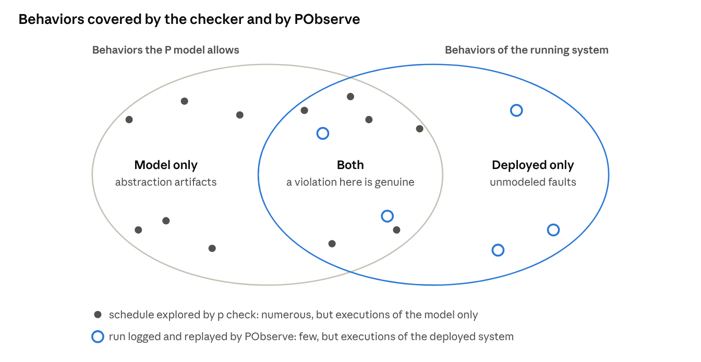

*Figure 12 · design-time and run-time checking share one set of monitors*

Design-time and run-time checking therefore share most of their definition of correctness, but not all of it. L1 and L2 are checked only by the checker, and R1 and R2 only by PObserve ([Section 5.6](#56-common-pitfalls)). The run-time monitors are an adequate substitute for the liveness monitors only if this is argued, in one of two ways: by showing that R1 implies L1 under the stated latency of the obligation manager (an obligation due at tick d is resolved by tick d + 1), and that R2 implies L2 under a stated maximum drain time; or by adding an announcement emitted *after* the obligation manager has processed a tick (for instance `eTickProcessed`), so that R1 and R2 can also be checked against the model.

PObserve reports assertion failures but not hot states that remain open at the end of a finite log. Liveness properties are therefore reformulated as **bounded-response** properties for run-time checking; e.g., *"resolved within 1 tick of the deadline"*.

On a finite log, the absence of a reported violation is a verdict of *inconclusive* rather than *holds* for every property that a longer log could still violate ([Section 3.4](#34-norms-as-temporal-properties)).

**Scope of each check.** The checker and PObserve answer different questions, and neither can replace the other ([Figure 13](#figure-13)).

<a id="figure-13"></a>


*Figure 13 · what the checker and PObserve can each establish*

- **The checker** explores many schedules, but only of the model. A violation it reports is genuine only to the extent that the model is faithful; a violation in the "model only" region results from an abstraction, such as agents that release the envelope instantaneously. The absence of violations constitutes evidence about the design, bounded by the number of schedules explored.
- **PObserve** examines few executions, but executions of the deployed system. A violation it reports actually occurred, to the extent that the log is accurate. It provides no information about executions that were not logged, nor about faults that the log cannot represent, such as a sensor that failed to detect a person.
- **The overlap** is where the two techniques overlap: the same monitor, written once, evaluates both the design and the running system. A finding obtained with one technique should be reproduced with the other: a counterexample from the checker becomes a test log, and a PObserve violation becomes a new test case for the model.

The region outside both sets motivates a safety layer below the MAS: no software check covers a failure that can be expressed neither in the model nor in the log.

### 5.1 Types and data

P is statically typed. Its type system comprises:

- **Primitive types:** `int`, `bool`, `float`, `string`, `machine` (a reference to a machine) and `event`.
- **Collections:** `seq[T]`, `set[T]`, `map[K, V]`.
- **Tuples:** named, e.g. `(agent: int, res: int, ver: int)`.
- **Enums and type aliases:** `type tNormSet = (ver: int, closed: set[int]);`.

Values are copied when sent, so machines share no memory and all coordination takes place through messages. This is the reason why the coordinator and the cell controller can temporarily disagree, and it is this disagreement that the checker explores.

### 5.2 Machine lifecycle

```
machine CellController {
  var occupants: set[int];
  start state Init {
    entry (cfg: (resource: int, capacity: int)) {  // payload given to `new`
      goto Open;
    }
  }
  state Open {
    on eAccessRequest do (r: tAccess) { /* admit or deny */ }
    on eNormPrepare goto Draining;                // leave Open, enter Draining
    ignore eTick;                                 // explicitly not interested
  }
  state Draining {
    entry { /* stop admitting; ack when the envelope is empty */ }
    defer eNormPrepare;                           // keep it queued for later
  }
}
```

- `new CellController((resource = 0, capacity = 1))` creates a machine and executes the `entry` block of its start state with the given payload.
- `goto S` executes the `exit` block of the current state and then the `entry` block of `S`.
- `raise e` handles an event immediately within the same machine.
- `this` denotes the machine's own reference, which is used to receive replies.

### 5.3 Communication semantics

- `send m, e, payload;` is **asynchronous**: the sender continues immediately, and the event is appended to the single input queue of `m`.
- Events from one sender to one receiver are delivered in the order in which they were sent; events from different senders may interleave in any order. These interleavings constitute the search space of the checker.
- Messages are not lost by default. Failures, such as a crashed controller or a lost message, must be modeled explicitly, e.g., by a machine that may drop or delay messages using `$`.
- **Unhandled events are errors.** If a machine receives an event that its current state neither handles, defers nor ignores, the checker reports a bug. This mechanism exposes protocol gaps early, such as the controller receiving `eRelease` while draining. `defer` and `ignore` should therefore be introduced deliberately and not merely to suppress checker reports.

### 5.4 Specification monitors

A `spec` machine is a global observer with the following characteristics:

- It declares the events it `observes` and executes synchronously whenever one of them is sent or announced.
- It cannot send events; it can only update its own variables and evaluate `assert` statements.
- An execution may terminate in a **cold** state, whereas a **hot** state must eventually be left. If a run terminates in a hot state, or remains in a hot state for longer than the checker's liveness threshold, the checker reports a liveness violation ([Section 5.10](#510-what-a-hot-state-violation-means)).
- `announce e, payload;` delivers an event to monitors only. Machines use it to publish institutional facts (an entry, a commit, a sanction) without sending them to another machine.

### 5.5 How the checker explores

The checker replaces the scheduler of the real system. At each step, it determines which machine executes next and how each `$` choice is resolved.

A run up to a bound on the number of steps is called a **schedule**, and `-s 10000` requests 10,000 schedules. Exploration strategies range from random choices to priority-based strategies designed to reach deep bugs with few context switches. Each bug is reported together with the seed that reproduces it.

The search finds bugs but does not prove their absence. Models should therefore be kept small (two agents, one technician, a bounded clock) and enlarged only after the small model passes.

**Why interleavings matter.** Concurrent systems fail because of particular orderings of events rather than because of individual events. Consider three events during the lock-out: the arm leaves the envelope (L), the coordinator commits the new norm set (C), and the technician enters (H). Since the technician waits for the commit, H always follows C, which leaves three possible orders ([Figure 14](#figure-14)).

<a id="figure-14"></a>

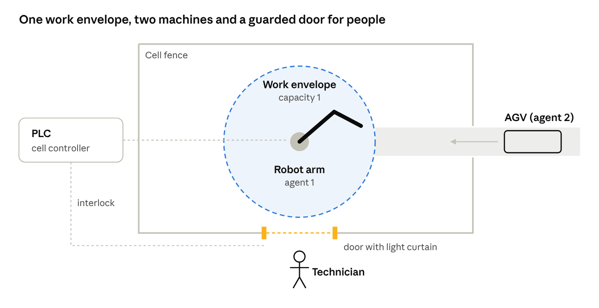

*Figure 14 · the orders of three lock-out events, and the one that violates S1*

Two of these orders are safe. The third, C followed by H and then L, places the technician in the envelope together with the arm. Testing would reveal this order only if the scheduler happened to deliver the messages in that sequence, which may be rare on a lightly loaded controller. The checker, in contrast, controls the scheduler and samples schedules with randomized strategies biased toward short races, so that a race involving three events is typically found within seconds; [Section 5.9](#59-what-a-number-of-schedules-guarantees) quantifies this.

The figure also illustrates the effect of a design correction. The two-phase protocol does not reduce the probability of the unsafe order; it eliminates that order, because the coordinator commits only after every guard has reported that its resource is empty. A correction that merely makes a race less frequent, such as a delay before the commit, leaves the branch in the tree, and the checker will continue to find it.

### 5.6 Common pitfalls

- **Over-deterministic test drivers.** If the test always starts the technician after the agents, many bugs cannot manifest. Nondeterministic choices (`$`) and multiple drivers should be used to widen the set of orderings.
- **Monitor timing.** A monitor observes an event when it is *sent*, before the receiver processes it; a clock tick is therefore visible to a monitor before the organization has applied it. For this reason, the run-time deadline monitors (R1, R2) are not used in the checker.
- **Liveness and fairness.** Hot-state checks depend on fairness assumptions ([Section 5.10](#510-what-a-hot-state-violation-means)). A reported violation caused solely by never scheduling an enabled machine does not correspond to a real defect, whereas a violation caused by a nondeterministic choice of an agent does.
- **Unbounded models.** An unbounded clock or retry loop produces unbounded schedules. Such loops must be bounded (`maxTicks`, a retry limit), and the bounds must be stated in the report.

### 5.7 Mapping normative concepts to P

| Normative concept | P construct | Where in the starter kit |
| --- | --- | --- |
| Norm set (lock-out status) | a versioned tuple `tNormSet` | `Common/MonitorEvents.p` |
| Regimented prohibition | admission check in a machine + `assert` in a monitor | `ResourceGuard.p`, `Specs.p` (S1) |
| Obligation instance | an entry in a `map` keyed by obligation id | `ObligationManager.p` |
| Deadline | logical clock events `eTick` | `Clock.p` |
| Violation and sanction | deadline check on each tick, then `eSanction` + `announce eSanctionApplied` | `ObligationManager.p` |
| Constitutive rule (count-as) | which `announce` a machine makes; at run time, the log parser | machines; `CellRegulationParser.java` |
| Adaptation (detect, design, execute) | coordinator states and the prepare/ack/commit events | `AdaptationCoordinator.p` |
| Open agent | nondeterministic `$` choices | `CellAgent.p` |
| Lock-out procedure | a monitor over `eNormCommitted` and `eHumanEntered` | `RuntimeSpecs.p` (R3) |

### 5.8 PObserve in more detail

- **Partition keys.** The parser assigns a key to each event. All events with the same key are delivered, in timestamp order, to a dedicated instance of the monitor. The key must be chosen so that every property depends only on the events of a single key. In this project, the key is the cell (site), which allows several cells to share one log file.
- **Ordering.** PObserve evaluates the events of each key in timestamp order. The parser must therefore emit events with strictly increasing timestamps within a key; lines that violate this order are reported as errors rather than silently reordered, and the order of events with equal timestamps is not specified (INSTRUCTIONS §3.9). PObserve also maintains a replay window of recent events (`--replay`) for reporting. Timestamps require microsecond precision.
- **Parser contract.** `apply(logLine)` returns a stream of zero or more events, and an empty stream for lines that do not represent regulation events. The parser must hold no static mutable state, because PObserve executes parsers on several threads.
- **Generated classes.** `p compile --mode pobserve` names tuple classes after their abbreviated field names; e.g., `(agent, res, ver)` yields `PTuple_agent_res_ver`. The generated `PTypes.java` should be inspected before the parser is written.
- **Execution modes.** JUnit tests are suited to continuous integration on recorded logs, whereas the CLI is suited to on-demand checking of production logs.

**Clock skew and causal order.** The log of the cell merges lines from several sources: the cell controller (PLC), the organizational engine, and the door switch or light curtain. Each source timestamps its lines with its own clock, so the timestamp order of the merged log coincides with the causal order of the events only if the clocks are synchronized more precisely than the shortest interval between causally related events. A skew of a few milliseconds can therefore swap a `HUMAN_ENTER` and a `LEAVE`, producing a false S1 violation or hiding a genuine one. Three measures mitigate the problem: synchronizing the clocks (NTP or, preferably, PTP) and recording the accuracy achieved; logging causally related events from a single source wherever possible; and relying on logical information that does not depend on clocks. The version number `Ver` of the norm set is such a logical clock: S2 compares the version under which an agent was admitted with the committed version, so its verdict does not depend on the timestamps of the two lines. Properties that relate events from different sources without such a field, such as S1 and R3, inherit the clock accuracy as a threat to validity ([Section 7.7](#77-modeling-assumptions-and-threats-to-validity)).

**Learning path (days 1–7):**

- [ ] Installation of P and completion of the [P-Tutorial](https://github.com/perkusic/P-Language/tree/main/P-Tutorial) of this repository (installation, a first program, specification monitors and the checker).
- [ ] Further reading: the official P tutorials ([p-org.github.io/P](https://p-org.github.io/P/)), in particular ClientServer and TwoPhaseCommit.
- [ ] Study of the PObserve documentation: [overview](https://p-org.github.io/P/advanced/pobserve/pobserve/), [log parser](https://p-org.github.io/P/advanced/pobserve/logparser/) and [CLI](https://p-org.github.io/P/advanced/pobserve/pobservecli/).
- [ ] Build and execution of the LockServer PObserve example in the P repository (`Src/PObserve/Examples/LockServerPObserve`).
- [ ] Reading of [Desai et al., PLDI 2013](https://www.microsoft.com/en-us/research/publication/p-safe-asynchronous-event-driven-programming-2/), sections 1–3.

### 5.9 What a number of schedules guarantees

`p check` does not enumerate all schedules. In each iteration, it executes one schedule chosen by a randomized strategy: uniformly random scheduling, or priority-based strategies such as PCT ([Burckhardt et al.](https://doi.org/10.1145/1736020.1736040)), which assigns random priorities to machines and changes them at a small number of randomly chosen steps. The strategies available, and their command-line names, depend on the installed P version (`p check --help`).

- **Probabilistic guarantee.** A bug has *depth* d if it manifests whenever d particular ordering constraints between events are satisfied. For a program with n machines and at most k steps per schedule, a single PCT run finds a bug of depth d with probability at least 1/(n·k^(d−1)). The three-event race of [Figure 14](#figure-14) has depth 2; with about 6 machines and 200 steps, a single run finds it with probability at least 1/1200, and 10,000 runs miss it with probability below (1 − 1/1200)^10000 ≈ 2.4·10⁻⁴. Deeper bugs require many more runs, and random scheduling offers no comparable bound.
- **Small-scope hypothesis.** Most protocol defects manifest in small configurations (Jackson). The models of this project are therefore deliberately small, and each result is a statement about the configuration checked (two agents, one or two technicians, `maxTicks` = 10), not about cells of arbitrary size.
- **Calibration with seeded bugs.** The adequacy of a schedule count can be estimated empirically. A known bug (the naive policy, or a mutant from [Section 5.11](#511-sanity-and-vacuity-checks)) is reintroduced, and the number of schedules until its first detection is recorded for several seeds. A claim about the corrected model should rest on a schedule count well above the largest of these numbers, for example ten times larger.
- **Reporting.** Every result states the test case, the number of schedules, the strategy, the maximum number of steps per schedule, the seeds, the running time and the P version.

### 5.10 What a hot-state violation means

A hot state expresses an obligation of the system: the monitor must eventually leave it. Since no finite schedule can show that something never happens, the checker relies on two approximations:

- **Termination in a hot state.** If a schedule ends because no machine has an event left to process while a monitor is in a hot state, the obligation can no longer be discharged. This is a genuine liveness violation, typically a deadlock or a missing reaction.
- **Hot for too long.** If a monitor remains hot for more than a threshold number of steps (the liveness *temperature* threshold), the checker reports a potential liveness violation. Such a report depends on the scheduler, because a long hot period may only reflect a machine that has not yet been scheduled. The name and default of the corresponding option depend on the P version.

**Fairness.** Liveness properties hold only under fairness assumptions about the scheduler. *Weak fairness* requires that an action that is continuously enabled is eventually taken; *strong fairness* requires that an action that is enabled infinitely often is taken infinitely often. For liveness checking, the scheduler is treated as weakly fair with respect to machines: a machine with a pending event is eventually executed. Nondeterministic choices (`$`) are **not** assumed to be fair. An agent whose choices keep it in the envelope forever exhibits a legitimate behavior of an open agent, and the resulting L2 violation is a genuine finding (experiment E3), not an artifact.

**Assumptions of L1 and L2.** L1 requires that the clock keeps ticking and that the obligation manager processes every tick, i.e., weak fairness for the `Clock` and `ObligationManager` machines; it does not depend on the agents, because a sanction resolves an obligation without their participation. L2 requires, in addition to weak fairness for the coordinator and the guard, that every agent inside the envelope eventually releases it. This is an assumption about agents that an open system cannot guarantee.

**Classifying a reported liveness violation.**

1. Determine whether the schedule terminated (no pending events) or was cut by the step bound or the threshold.
2. If it terminated, the violation is genuine: identify the event that should have discharged the hot state.
3. If it was cut, determine whether some machine had pending events throughout. If so, rerun with the same seed and a larger step bound before drawing conclusions.
4. If the hot state persists because of a `$` choice, or because a machine waits for an event that is never sent, the violation is genuine.

### 5.11 Sanity and vacuity checks

A monitor that never fails establishes nothing unless it is known that it *can* fail. Two features of the starter kit make this concern concrete:

- **The final far-future tick.** After `maxTicks`, the `Clock` emits a tick that passes every deadline, and the obligation manager sanctions every open obligation. L1 therefore holds whenever the obligation manager is correct, irrespective of agent behavior; it would also hold if no obligation were ever created. L1 tests the obligation manager, not the agents, and only if obligations are actually created.
- **The well-behaved technician.** `HumanRequester` enters only after the commit, so R3 holds in the model by construction. R3 is informative only at run time, where real technicians may bypass the procedure.

For every monitor, the project must therefore provide (a) a **mutant** of the model or of a log that is expected to violate it, with evidence that the monitor reports the violation, and (b) **event-coverage evidence** for passing runs, i.e., the number of occurrences of each observed event, showing that the antecedent of the property was exercised. Suggested mutants are listed below.

| Property | Mutant expected to violate it |
| --- | --- |
| S1 | the guard ignores the closed set of the norm set |
| S2 | the naive policy (E2) |
| S3 | the obligation manager records a report that arrives after the sanction |
| S4 | two technicians without tracking of lock-out holders (E4) |
| L1 | the deadline check is removed from the obligation manager and the far-future tick is disabled |
| L2 | an agent that never releases the envelope (E3) |
| R1 | a log from which a `SANCTION` line has been deleted |
| R2 | a log in which a `COMMIT` line has been delayed beyond the bound |
| R3 | a `HumanRequester` that enters without waiting for the commit; a log with `HUMAN_ENTER` before `COMMIT` |

## 6. The system: a regulated manufacturing cell

A robot arm (agent 1) and an automated guided vehicle (AGV, agent 2) share one work envelope (resource 0, capacity 1). A single cell controller admits agents to the envelope, and an organizational engine assigns jobs with deadlines. At unpredictable times, a maintenance technician must enter the cell; this first requires a **lock-out**, i.e., a regulation adaptation that closes the envelope to agents. [Figure 1](#figure-1) shows the layout of the cell, and [Figure 15](#figure-15) its architecture by MAOP dimension.

<a id="figure-15"></a>

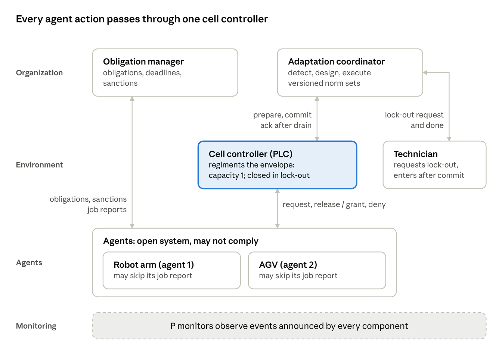

*Figure 15 · cell architecture, components by MAOP dimension*

The cell controller is the only means of access to the envelope, so regimented norms hold as long as its norm set is current. Keeping the norm set current during a lock-out is the responsibility of the coordinator, and the correctness of this function is the object of verification in this project.

**Normal operation.** The cell operates as follows:

1. The organizational engine assigns a job to an agent, thereby creating an obligation with a deadline.
2. The agent requests access to the envelope from the cell controller.
3. If the envelope is open and unoccupied, the controller admits the agent; otherwise, it denies the request, and the agent retries up to three times before abandoning the job.
4. The agent performs the work, releases the envelope and reports completion. In an open system, an agent may fail to report.
5. If the deadline elapses without a report, the organization sanctions the agent.

**Lock-out (regulation adaptation).** The lock-out proceeds in the following steps:

1. **Detect.** The technician requests the lock-out.
2. **Design.** The adaptation coordinator computes the next norm set, with the version incremented by one and resource 0 closed.
3. **Execute.** The new norm set is installed in the controller, after which the technician is authorized to enter.
4. Upon leaving, the technician requests the reverse adaptation, which reopens the envelope.

**Norms of the cell.** The norms in force are summarized below:

| Norm | Modality | Enforcement | Level | Properties |
| --- | --- | --- | --- | --- |
| At most one agent in the envelope | prohibition | regimented by the cell controller | physical safety | S1 |
| No agent in the envelope while a person is inside | prohibition | regimented by the cell controller | physical safety | S1 |
| A person enters only after the lock-out is committed | obligation on the procedure | monitored | safety procedure | R3 |
| Report a job before its deadline | obligation with deadline | sanctioned by the organization | performance | L1, R1 |
| A job ends either fulfilled or sanctioned, never both | integrity of the organization | by construction, monitored | organizational | S3 |
| Admissions follow the committed norm set, and norm sets are installed in version order | obligation on the controller and the coordinator | by construction, monitored | adaptation | S2 |
| A requested lock-out is eventually installed, within a bounded time | obligation on the coordinator | monitored | adaptation | L2, R2 |
| A resource is reopened only when no person is inside | prohibition on the coordinator | by construction after the fix of E4, monitored | adaptation and safety | S4 |

**Execution policies.** Two policies for executing the lock-out are compared ([Figure 16](#figure-16)):

- **Naive.** The coordinator declares the new norm set immediately, and the controller installs it whenever the corresponding message arrives.
- **Two-phase.** The coordinator sends *prepare*; the controller stops admitting agents, waits until the envelope is empty (drain) and then acknowledges. Only after the acknowledgement does the coordinator *commit*.

<a id="figure-16"></a>


*Figure 16 · naive vs. two-phase lock-out, as message sequences*

In the naive sequence, the controller still holds norm set v0 when the arm requests entry, because v1 is still in transit. The two-phase sequence cannot reach this state, since the technician is authorized to enter only after the controller has drained the envelope and acknowledged.

The naive policy corresponds to a typical first implementation. Demonstrating *why* it is unsafe constitutes the central result of the project.

**The two-phase protocol as state machines.** In the starter kit, the protocol is distributed over two P machines ([Figure 17](#figure-17)): the `AdaptationCoordinator` and one `ResourceGuard` per resource.

<a id="figure-17"></a>

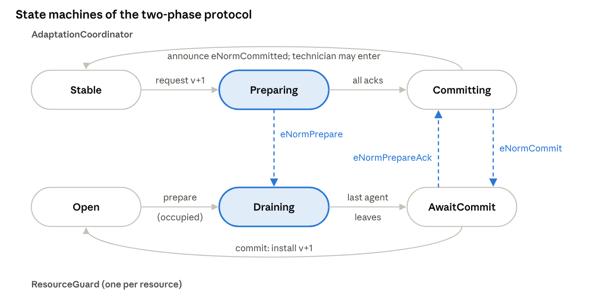

*Figure 17 · the two-phase protocol as two communicating state machines*

- **Prepare.** The coordinator sends `eNormPrepare` to every guard. A guard whose resource is closed by the new norm set enters the state `Draining`, in which it denies every new request but allows current occupants to finish. An empty or unaffected guard acknowledges immediately and proceeds directly to `AwaitCommit`.
- **Acknowledge.** When the last agent leaves, the guard sends `eNormPrepareAck` and waits. It continues to deny requests, because it does not yet know whether the commit has taken place.
- **Commit.** Only after receiving all acknowledgements does the coordinator announce `eNormCommitted`, which the monitors observe and which authorizes the technician to enter. It then sends `eNormCommit` so that each guard installs the new version.

The safety argument rests on the highlighted states. Between `Preparing` and the commit, the closed resource is empty and inaccessible, so there is no instant at which a guard admits an agent under the previous rules while the technician acts under the new ones. The naive design omits both highlighted states. The cost of the protocol is equally apparent: if an occupant never leaves, the coordinator remains in `Preparing` indefinitely. For this reason, L2 (`AdaptationCompletes`) is a liveness property that must be checked, and the experiments deliberately remove releases.

## 7. Technical specification

The deliverable is a P project consisting of three parts:

- a model of the cell;
- a catalogue of monitors checked against that model;
- a PObserve package that checks the same monitors against execution logs.

A starter kit containing draft versions of all three parts is provided ([Section 9](#9-starter-kit-setup-and-references)). The work consists of making the kit compile, correcting it, justifying every modeling decision, and extending it.

### 7.1 Model components

| P machine | Unified-view role | MAOP dimension | Responsibility |
| --- | --- | --- | --- |
| `CellAgent` (×2) | regulated agent | agent | requests the envelope, works, releases; reports or not (`$`) |
| `ResourceGuard` | regimentation | environment | admits or denies by norm set and capacity; drains during prepare |
| `ObligationManager` | sanctioning | organization | creates obligations, checks deadlines on each tick, sanctions |
| `AdaptationCoordinator` | adaptation (detect → design → execute) | organization | versioned norm sets; two-phase or naive policy |
| `HumanRequester` | source of the detect-fact | environment (human) | requests the lock-out, enters on commit, leaves, requests reopening |
| `Clock` | time | — | logical ticks; one final far-future tick so that every deadline passes (which makes L1 hold whenever the obligation manager is correct; [Section 5.11](#511-sanity-and-vacuity-checks)) |

### 7.2 Property catalogue

| Id | Monitor | Class | Enforcement | Checked by | Expected with two-phase / naive |
| --- | --- | --- | --- | --- | --- |
| S1 | `RegimentationSafety`: capacity never exceeded; never an agent and a person together | safety | regimented | checker + PObserve | holds / **violated** |
| S2 | `NoStaleAdmission`: no admission to a resource the committed norm set closes; versions in order | safety | regimented | checker + PObserve | holds / **violated** |
| S3 | `NoDoubleOutcome`: an obligation is never both fulfilled and sanctioned | safety (integrity) | by construction | checker + PObserve | holds / holds |
| S4 | to be written in E4: no committed norm set opens a resource while a person is inside | safety | regimented after the fix | checker + PObserve | one technician: holds / holds; two technicians, starter kit: **violated** / **violated**; after the fix: holds |
| L1 | `EveryObligationResolved`: every obligation is eventually fulfilled or sanctioned | liveness (hot state) | sanctioned | checker | holds / holds (see [Section 5.11](#511-sanity-and-vacuity-checks) on vacuity) |
| L2 | `AdaptationCompletes`: every adaptation eventually commits | liveness (hot state) | adaptation | checker | holds / holds, provided that agents release the envelope (fails in E3) |
| R1 | `ObligationDeadlineRespected`: resolved no later than tick Due + 1 | bounded response | sanctioned | PObserve | holds / holds |
| R2 | `AdaptationBoundedTime`: commits within B ticks of the start (B = 5 in the starter kit, to be calibrated) | bounded response | adaptation | PObserve | holds / holds if B is at least the maximum drain time |
| R3 | `LockoutBeforeEntry`: a person enters only a locked-out resource | safety (procedure) | monitored | checker + PObserve | holds / holds (by construction in the model; [Section 5.11](#511-sanity-and-vacuity-checks)) |

The expected outcomes are **hypotheses** derived from the design. A sample-log simulator agrees with them, but they have not yet been confirmed with `p check`; their confirmation or refutation is part of the project.

### 7.3 Experiments (priorities in 7.5)

| # | Experiment | Change to the model | Design hypothesis | Acceptance criterion | Minimum schedules | Evidence to record |
| --- | --- | --- | --- | --- | --- | --- |
| E1 | Baseline, two-phase | none | S1–S3, L1, L2 and R3 hold | no violation; schedule count justified by calibration ([Section 5.9](#59-what-a-number-of-schedules-guarantees)) | 100,000 | command, versions, strategy, seeds, event coverage |
| E2 | Baseline, naive | `twoPhase = false` | S1 or S2 fails | a counterexample explained with the template of [Section 7.8](#78-writing-up-a-counterexample) | until the first violation (at most 10,000) | trace, seed, write-up |
| E3 | Stuck agent | an agent never releases the envelope | L2 fails; the safety properties hold | the liveness violation classified as genuine ([Section 5.10](#510-what-a-hot-state-violation-means)) | 10,000 | trace, classification, argument for an e-stop |
| E4 | Two technicians | a second `HumanRequester` | S1 and S4 fail on reopening; after the fix, all monitors hold | failing trace before the fix; no violation after it | 100,000 after the fix | both traces or runs, S4, the fix |
| E5 | Deadline pressure | `due` reduced from 4–6 to 2 | more sanctions; S3 and L1 still hold | sanction counts reported per setting; no violation | 10,000 per setting | counts, runs |
| E6 | Scale | 3–4 agents, larger `maxTicks` | checker time per schedule grows with the configuration | schedules per second reported per configuration | 1,000 per configuration | timing table |
| E7 | Sanctions during a lock-out (optional) | a monitor stating that no obligation is sanctioned whose agent was denied access during a lock-out within the obligation's active period | the monitor fails under the starter kit's sanction policy | a trace showing the denial and the sanction; a remedy discussed or modeled | 10,000 | trace, policy discussion |
| E8 | Cancelling a prepare (optional) | the technician withdraws before the commit; an abort message is added | without abort, the lock-out is committed although no longer needed; with abort, S1–S4 still hold and the envelope reopens | abort path modeled and checked | 10,000 | model change, results |

Before each run, the team records its own prediction in the experiment log (ASSIGNMENT.md); the design hypotheses above do not replace that prediction. A result that contradicts a hypothesis is a finding, not a failure, provided it is explained.

### 7.4 Run-time part (PObserve)

**Log contract.** Each regulation event is recorded as one log line:

- `Site=cell-A, Event=ENTER, Agent=1, Res=0, Ver=0`
- also `CONFIG`, `TICK`, `OBLIGATION`, `FULFILLED`, `SANCTION`, `LEAVE`, `ADAPT_START`, `COMMIT`, `HUMAN_ENTER`, `HUMAN_LEAVE`

Each line is prefixed by a UTC timestamp with microsecond precision. `Site` is the partition key.

**Package.** The package is a Gradle project that runs `p compile --mode pobserve` on the monitors only, together with a Java parser, JUnit tests and a CLI runner script.

**Validation.** The package is validated against the following criteria:

- the two-phase sample log passes every safety monitor;
- the naive sample log fails S1 and S2;
- **system faults (true positives):** R1 and R2 detect faults injected into the regulated system, namely a deleted `SANCTION` line (an obligation that is never resolved) and a delayed `COMMIT`;
- **log defects (false results):** the effect of at least two defects of the logging itself, such as a missing `LEAVE` or a duplicate `COMMIT` (INSTRUCTIONS §3.9), is reported together with an explanation of why the resulting verdict is wrong;
- the bound B of R2 is calibrated from data, since R2 holds on a log only if B is at least the maximum drain time observed.

**Instrumentation (stretch goal).** The log is emitted from a small JaCaMo implementation of the cell using the `RegulationLog.java` helper, and PObserve is run on that log.

### 7.5 Requirements

| Priority | Requirement |
| --- | --- |
| Must | All P files compile; E1 and E2 run; each result is explained with the trace or report |
| Must | E4: the two-technician failure is reproduced, S4 is written, the regulation is fixed, and all monitors hold after the fix |
| Must | Every monitor is traced to a norm of [Section 6](#6-the-system-a-regulated-manufacturing-cell) ([Section 7.6](#76-traceability)) and has a mutant that violates it ([Section 5.11](#511-sanity-and-vacuity-checks)) |
| Must | The schedule count behind every claim is justified ([Section 5.9](#59-what-a-number-of-schedules-guarantees)) |
| Must | The PObserve package builds; both JUnit tests pass on the sample logs; the system-fault and log-defect runs of [Section 7.4](#74-run-time-part-pobserve) are reported |
| Must | The assumptions table of [Section 7.7](#77-modeling-assumptions-and-threats-to-validity) is completed and discussed as threats to validity in the report |
| Should | E3 and E5; calibration of the R2 bound |
| Could | E6, E7 and E8; JaCaMo instrumentation and a run on its logs; comparison with a Maude or UPPAAL encoding of one property |

### 7.6 Traceability

Each property is traced to the norm it protects, its temporal form, its class, its enforcement mechanism, the technique that checks it, the test case that exercises it and the log events it reads. The table is to be kept up to date as monitors are added or changed.

| Norm ([Section 6](#6-the-system-a-regulated-manufacturing-cell)) | Property | Temporal form | Class | Enforcement | Checked by | Test case | Log events |
| --- | --- | --- | --- | --- | --- | --- | --- |
| at most one agent; no agent with a person | S1 | G(occupancy ≤ capacity) ∧ G ¬(agentIn ∧ personIn) | safety | regimented | checker, PObserve | `tcCellTwoPhase`, `tcCellNaive` | `CONFIG`, `ENTER`, `LEAVE`, `HUMAN_ENTER`, `HUMAN_LEAVE` |
| admissions follow the committed norm set | S2 | G(enter(r, v) → r ∉ closed(committed) ∧ v = version(committed)); versions increasing | safety | regimented | checker, PObserve | both | `ENTER`, `COMMIT` |
| one outcome per job | S3 | G(fulfilled(o) → G ¬sanctioned(o)), and conversely | safety | integrity | checker, PObserve | both | `FULFILLED`, `SANCTION` |
| reopen only when no person is inside | S4 | G(commit(v) ∧ r ∉ closed(v) → ¬personIn(r)) | safety | regimented after the fix | checker, PObserve | two-technician test (E4) | `COMMIT`, `HUMAN_ENTER`, `HUMAN_LEAVE` |
| report before the deadline | L1 | G(created(o) → F resolved(o)) | liveness | sanctioned | checker | both | — |
| report before the deadline | R1 | G(created(o, d) → resolved(o) by tick d + 1) | bounded response | sanctioned | PObserve | sample logs | `OBLIGATION`, `FULFILLED`, `SANCTION`, `TICK` |
| lock-out eventually installed | L2 | G(started → F committed) | liveness | adaptation | checker | both; E3 | — |
| lock-out installed in bounded time | R2 | G(started at t → committed by t + B) | bounded response | adaptation | PObserve | sample logs | `ADAPT_START`, `COMMIT`, `TICK` |
| person enters only after the commit | R3 | G(personEnters(r) → r ∈ closed(committed)) | safety | monitored | checker, PObserve | both | `HUMAN_ENTER`, `COMMIT` |

### 7.7 Modeling assumptions and threats to validity

A model **over-approximates** the real system if every real behavior is also a behavior of the model; safety verdicts then transfer from the model to the system. It **under-approximates** the system if some real behaviors are missing; a violation found in the model then corresponds to a real execution, provided the model's behaviors are feasible, but the absence of violations does not transfer. The starter kit makes the following assumptions, most of which are under-approximations.

| Assumption of the model | Counterpart in a real cell | Approximation | Properties affected |
| --- | --- | --- | --- |
| Agents interact only through the protocol (request, release, report) and never enter without a grant | a robot may move without permission after a software or hardware fault | under-approximation | S1, S2: a safe verdict does not cover rogue motion |
| Messages are neither lost nor duplicated and are delivered in order per sender–receiver pair | OPC UA and network links may lose, delay or duplicate messages | under-approximation | S2, L2, R2 |
| Release is instantaneous; motion is abstracted to occupancy | an arm needs time and space to leave the envelope | abstraction | S1 (timing of exit) |
| One guard, one resource of capacity 1, two agents | cells with several zones and more agents | scope restriction | all; small-scope argument ([Section 5.9](#59-what-a-number-of-schedules-guarantees)) |
| Logical ticks; deadlines in ticks | wall-clock time with jitter | abstraction | L1, R1, R2 |
| The technician waits for the commit | people may bypass the procedure | under-approximation | R3 (holds by construction in the model) |
| Sensors detect persons without error | light curtains fail or are muted | under-approximation | S1, R3: no software check covers sensor failure |
| Bounded runs: `maxTicks` = 10, three denials, final far-future tick | unbounded operation | bounded | L1, L2 ([Section 5.11](#511-sanity-and-vacuity-checks)) |
| Agents' `$` choices cover compliance and non-compliance within the protocol | learning or vendor-supplied agents | over-approximation of agent decisions within the protocol | sanction-related properties |
| Log timestamps reflect causal order | clocks of several sources with skew | depends on synchronization | S1, R3 at run time ([Section 5.8](#58-pobserve-in-more-detail)) |

**Threats to validity** are the reasons why a reported result might not hold for the real cell. *Internal validity* concerns errors in the model, the monitors or the parser. *Construct validity* concerns whether the monitors express the intended norms, including the count-as mapping of the parser ([Section 3.6](#36-constitutive-rules-situated-artificial-institutions)) and vacuity ([Section 5.11](#511-sanity-and-vacuity-checks)). *External validity* concerns whether results obtained for the small configuration generalize to real cells, with their timing, sensors and scale. The report must contain a threats-to-validity section that discusses each assumption of the table above under these three headings.

### 7.8 Writing up a counterexample

Every counterexample reported in D2 and D4 follows the same template:

1. **Setup.** Test case, configuration, P version, strategy, seed and schedule number.
2. **Shortest violating prefix.** The events that lead to the violation, restricted to the relevant machines and drawn as a message-sequence chart in the style of [Figure 10](#figure-10).
3. **Failing monitor.** The monitor, its assertion message, and the state of the monitor at the failure.
4. **Root cause.** The design decision that permits the interleaving, linked to a hazard of [Section 4.5](#45-consistency-during-a-regulation-change).
5. **Classification.** A genuine defect of the design, or an artifact of the model (with reference to the assumptions of [Section 7.7](#77-modeling-assumptions-and-threats-to-validity), and to [Section 5.10](#510-what-a-hot-state-violation-means) for liveness violations).
6. **Fix.** The change to the model or to the regulation.
7. **Regression.** The rerun that shows that the fixed model satisfies the monitor, with its schedule count, and that no other monitor was weakened.

The excerpt below annotates the first violation in the sample log `cell_naive.log`. It is an illustrative log excerpt generated by the simulator, not output of the checker; a checker trace has the same structure but lists machine steps instead of log lines.

```
08:00:02.002  ENTER        Agent=1 Res=0 Ver=0   the arm enters under norm set v0
08:00:03.002  ADAPT_START  Ver=1                 the technician's request is detected
08:00:03.003  COMMIT       Ver=1 Closed=0        naive policy: v1 is committed before the envelope has drained
08:00:03.004  HUMAN_ENTER  Res=0                 S1 violated: the arm is still inside
08:00:03.005  LEAVE        Agent=1 Res=0         the arm leaves only now
08:00:03.007  ENTER        Agent=2 Res=0 Ver=0   S2 violated: admission under v0 after v1 was committed
```

The root cause is hazard 2 (premature entry) for S1 and hazard 1 (stale admission) for S2: under the naive policy, the commit is not preceded by a drain, and the controller installs v1 only after the coordinator has authorized the technician.

## 8. Work plan and deliverables

The project is carried out in five phases over 45 calendar days, counted from the start date. Each phase lasts 7 to 11 days and concludes with a short checkpoint meeting and a tagged commit ([Figure 18](#figure-18)).

<a id="figure-18"></a>


*Figure 18 · work plan: 5 phases, 45 days, 5 deliverables*

| Phase | Days | Activities | Exit criterion (checkpoint) |
| --- | --- | --- | --- |
| Background | 1–7 | toolchain; P-Tutorial; reading of Yan et al.; first `p compile` with the errors recorded; mapping of each machine to a regulation capability | D1 submitted; first compilation log recorded |
| Model | 8–17 | compilation errors fixed; E1, E2 and at least three further experiments, each with a prediction recorded before the run | day 17: P steps of the validation record completed; experiment log with predictions, results and explanations |
| Verification | 18–28 | E4: two-technician failure (days 18–22); S4, fix and re-verification (days 23–28); mutants for every monitor ([Section 5.11](#511-sanity-and-vacuity-checks)); calibration of schedule counts ([Section 5.9](#59-what-a-number-of-schedules-guarantees)) | D2 submitted |
| Run time | 29–38 | PObserve package; sample logs; logs of the two-technician scenario; system-fault and log-defect runs; calibration of the R2 bound | D3 submitted |
| Analysis | 39–45 | report, threats to validity, presentation | D4 and D5 submitted |

The verification phase constitutes the core of the project. If modeling is delayed, the optional JaCaMo instrumentation of the run-time phase is to be omitted, rather than experiments E1, E2 or E4.

**Deliverables.** The deliverables and their due dates are listed below:

| # | Deliverable | Due (day) | Content |
| --- | --- | --- | --- |
| D1 | Background note | 7 | 2–3 pages: MAS, norms, the unified view, P; the cell placed in the grid, with justification; a one-page mapping of each machine in `Common/` to a regulation capability |
| D2 | Verified model | 28 | compiling P project; results of E1, E2 and the further experiments; the two-technician failing trace explained with the template of [Section 7.8](#78-writing-up-a-counterexample); S4; the fix and all monitors holding afterwards; mutants for every monitor; justification of every schedule count |
| D3 | PObserve package | 38 | parser (adapted as needed), JUnit tests, runner; results on all logs, including the two-technician scenario; system-fault and log-defect runs; the calibrated R2 bound with its justification |
| D4 | Final report | 45 | 8–12 pages in a workshop-paper format (e.g. EMAS, COINE or WESAAC), structured as below, with the validation record and the completed tables of [Sections 7.6](#76-traceability) and [7.7](#77-modeling-assumptions-and-threats-to-validity) as appendices |
| D5 | Presentation and demonstration | 45 | 15 minutes plus 5 for questions: one checker counterexample run live and one PObserve violation shown |

This section is the authoritative source for phases, deliverables and grading; ASSIGNMENT.md summarizes it for the teams.

**Grading and rubric.**

| Component | Deliverable | Weight | Excellent | Adequate | Insufficient |
| --- | --- | --- | --- | --- | --- |
| Background and capability mapping | D1 | 5% | every machine mapped to a capability with justification; position in the grid argued | mapping complete, justification brief | mapping incomplete or incorrect |
| Baseline and validation record | D2 | 10% | every step recorded with command, versions, seed and output; mutants for every monitor | most steps recorded; some mutants | results without evidence |
| Design experiments | D2 | 15% | predictions recorded before running; counterexamples explained with the template | predictions present; explanations partial | no predictions; traces reported without explanation |
| Two technicians: analysis and S4 | D2 | 20% | failure reproduced; interleaving explained; S4 fails before the fix | failure reproduced; explanation partial | failure not reproduced |
| Two technicians: fix and verification | D2 | 20% | all monitors hold; schedule count justified by calibration; no test weakened | monitors hold; justification weak | fix incomplete, or tests weakened |
| Run-time monitoring | D3 | 15% | all logs checked; R2 bound justified from data; system faults and log defects distinguished and analyzed | most logs checked; analysis partial | package does not build, or no analysis |
| Report and presentation | D4, D5 | 15% | claims match the evidence; threats to validity discussed per assumption; design-time / run-time split explained | minor overstatements | claims unsupported by evidence |

Individual grades may be adjusted on the basis of the contribution statements and the answers given during the presentation.

**Learning outcomes and assessment.** A dot marks the deliverables in which each learning outcome of [Section 1](#1-summary) is assessed.

| Learning outcome | D1 | D2 | D3 | D4 | D5 |
| --- | --- | --- | --- | --- | --- |
| LO1 position a design in the unified-view grid | ● |  |  | ● |  |
| LO2 formalize norms and adaptation in P |  | ● |  | ● |  |
| LO3 monitors, counterexamples, schedule counts |  | ● |  | ● | ● |
| LO4 PObserve, parser, faults and defects in logs |  |  | ● | ● | ● |
| LO5 design time versus run time |  | ● | ● | ● | ● |
| LO6 assumptions and threats to validity |  | ● | ● | ● |  |

**Report template (D4).**

1. Introduction and research questions.
2. Background and the position of the cell in the unified-view grid (from D1).
3. Model and norms, with the traceability table of [Section 7.6](#76-traceability).
4. Design-time results: E1–E8, each counterexample written up with the template of [Section 7.8](#78-writing-up-a-counterexample).
5. Run-time results: sample logs, the team's logs, system faults and log defects, calibration of the R2 bound.
6. Threats to validity, discussed per assumption of [Section 7.7](#77-modeling-assumptions-and-threats-to-validity).
7. Related work.
8. Conclusion.

Appendices: the validation record, and the completed tables of [Sections 7.6](#76-traceability) and [7.7](#77-modeling-assumptions-and-threats-to-validity).

## 9. Starter kit, setup and references

The `p-regulation` archive is given; its contents are identical to the project folder in the GitHub repository (see Repository and access). The folders `Common/`, `ManufacturingCell/` and `tools/` are used.

| Path | Content | Status |
| --- | --- | --- |
| `Common/*.p` | shared model machines and monitors | draft, not yet compiled |
| `ManufacturingCell/PSrc`, `PTst` | cell agents, system configuration, test cases | draft, not yet compiled |
| `ManufacturingCell/pobserve/` | Gradle build, parser, JUnit tests, sample logs | parser written against the PObserve API and exercised only with stand-ins for the generated classes; not yet built with `p compile --mode pobserve`; JUnit not yet run |
| `ManufacturingCell/INSTRUCTIONS.md` | step-by-step commands for both parts, log contract, validation record | written; commands not yet validated |
| `tools/simulate_logs.py` | generates two-phase / naive logs and previews monitor results | tested |
| `tools/instrumentation/RegulationLog.java` | logging helper for JaCaMo | compiles |

**Software environment.** The following tools are required:

- .NET SDK 8.0, then `dotnet tool install --global P`
- Java 17 or later
- Gradle 8.x
- Python 3

Alternatively, the Docker image `ghcr.io/p-org/p:latest`, which bundles .NET, a JDK and the `p` CLI, may be used. The PObserve CLI must be built once from the P repository (`Src/PObserve/PObserve`, `./gradlew build`).

**Getting started.** The following commands compile the model, check the naive test case, and build and run the PObserve package:

```
cd ManufacturingCell
p compile
p check -tc tcCellNaive -s 10000
cd pobserve && gradle wrapper && ./gradlew build uberjar && ./run_pobserve.sh
```

## Appendix A. Reading map, self-check questions, misconceptions and glossary

### A.1 Reading map

| Section | Essential | Needed by | Enrichment |
| --- | --- | --- | --- |
| 2 Multi-agent systems | 2 (introduction), 2.2, 2.4 | day 7 | 2.1, 2.3, 2.5 |
| 3 Norms | 3 (introduction), 3.1, 3.3, 3.4, 3.7, 3.8; from 3.2 the subsections "Deontic logic seen from temporal logic" and "One trace, two readings" | day 7 | remainder of 3.2, 3.5, 3.6 |
| 4 Regulation management | 4 (introduction), 4.5 | day 18 | 4.1–4.4, 4.6 |
| 5 P and PObserve | 5 (introduction), 5.3, 5.4, 5.5, 5.9, 5.10, 5.11 | day 8 | 5.1, 5.2, 5.6, 5.7 as reference |
| 5.8 PObserve in more detail | all | day 29 | — |
| 6 and 7.1–7.3 | all | day 8 | — |
| 7.4 Run-time part | all | day 29 | — |
| 7.6–7.8 | all | day 18 | — |

### A.2 Self-check questions

**[Section 2](#2-background-multi-agent-systems).** (1) Why must the correctness of an open MAS not depend on agent compliance, and how does the model reflect this? (2) In which MAOP dimension is the envelope regimented, and why there? (3) What distinguishes an agent's choice from a regulator's guarantee?

**[Section 3](#3-background-norms-and-normative-mas).** (1) Why would requiring G ¬V be a modeling error? (2) Why is O φ ∧ ¬φ consistent, whereas G φ ∧ ¬φ (in the current state) is not? (3) Which properties of [Section 7.2](#72-property-catalogue) are safety, liveness and bounded-response properties, and which of them can PObserve check?

**[Section 4](#4-background-regulation-management-in-mas).** (1) What is the transition window, and which property covers each of its hazards? (2) Why does the serialization of adaptations not make two technicians safe? (3) How does the prepare–drain–commit protocol differ from classical two-phase commit?

**[Section 5](#5-background-the-p-language-and-pobserve).** (1) Why can PObserve not check L1? (2) What does "no bug found in 10,000 schedules" establish, and how can that number be justified? (3) When is a reported liveness violation an artifact of the scheduler?

### A.3 Common misconceptions

- *"No bug in N schedules means that the design is correct."* It means that N sampled schedules of one configuration showed no violation ([Section 5.9](#59-what-a-number-of-schedules-guarantees)).
- *"A clean PObserve run means that the system is safe."* It means that the logged execution contains no bad prefix; for bounded properties whose deadline lies beyond the end of the log, the verdict is inconclusive ([Section 3.4](#34-norms-as-temporal-properties)).
- *"A monitor that never fails is a good monitor."* It may be vacuous ([Section 5.11](#511-sanity-and-vacuity-checks)).
- *"`defer` and `ignore` fix unhandled-event errors."* They hide them unless the protocol justifies them ([Section 5.3](#53-communication-semantics)).
- *"The two-phase protocol is two-phase commit."* It has neither votes nor an abort path ([Section 4.5](#45-consistency-during-a-regulation-change)).
- *"A sanction is a violation."* The violation is the missed deadline; the sanction is the regulator's reaction to it ([Section 3.2](#32-deontic-logic-in-brief)).
- *"A permission can be checked on a log."* Permission is a branching property ([Section 3.2](#32-deontic-logic-in-brief)).

### A.4 Glossary

| Term | Meaning in this specification |
| --- | --- |
| Agent | an autonomous entity that perceives, decides and acts; here, the arm and the AGV |
| Artifact | an environment object (CArtAgO) whose operations agents use and which may refuse an operation |
| BDI | belief–desire–intention agent model |
| Bounded response | a property requiring a reaction within a given number of ticks; a safety property over time |
| Checker | the P tool (`p check`) that executes schedules of a model and evaluates monitors |
| Cold state | a monitor state in which an execution may end |
| Constitutive rule | a count-as rule that relates physical facts to institutional facts |
| Contrary-to-duty obligation | an obligation that applies after another norm has been violated |
| Counterexample | a schedule or log prefix that violates a property |
| Deontic logic (SDL) | the modal logic of obligation (O), permission (P) and prohibition (F, Forb) |
| Detect, design, execute | the three capabilities of regulation adaptation |
| Drain | the phase in which the controller denies new requests and waits until the envelope is empty |
| Event | a typed message in P, sent to a machine or announced to monitors |
| Event coverage | the number of occurrences of each monitored event in a set of runs |
| Fairness (weak, strong) | assumptions that enabled actions are eventually taken ([Section 5.10](#510-what-a-hot-state-violation-means)) |
| Hot state | a monitor state that must eventually be left |
| Inconclusive verdict | the verdict of a finite trace that can be extended both to a violation and to a satisfaction |
| Interleaving | an order in which the events of concurrent machines are processed |
| Liveness property | a property requiring that something good eventually happens |
| Log parser | the Java component that maps log lines to P events and partition keys |
| Lock-out | the regulation adaptation that closes the envelope to agents before a person enters |
| Machine | a P state machine with local variables and an input queue |
| MAOP | multi-agent-oriented programming: agent, environment, interaction and organization dimensions |
| Monitor (spec) | a P observer that asserts a property over observed events |
| Monitorability | the property that every finite prefix can be extended to one with a conclusive verdict |
| Mutant | a deliberately faulty variant of a model or log used to show that a monitor can fail |
| Naive policy | the adaptation policy that commits before the controller has drained the envelope |
| Norm, norm instance | a conditional rule; an instance is created each time the rule is activated |
| Norm set | the versioned set of norms in force, here the set of closed resources |
| NPL | Normative Programming Language of JaCaMo |
| Obligation, prohibition, permission | the three deontic modalities |
| Open system | a MAS whose agents are not under the designer's control |
| Over-/under-approximation | a model with more / fewer behaviors than the real system ([Section 7.7](#77-modeling-assumptions-and-threats-to-validity)) |
| Partition key | the PObserve key that groups the events checked by one monitor instance |
| PCT | probabilistic concurrency testing, a randomized scheduling strategy with a probabilistic guarantee |
| PObserve | the tool that checks logs against P monitors |
| Prepare–drain–commit | the two-phase adaptation protocol of this project |
| Regimentation | enforcement that makes a violation impossible |
| Regulation adaptation | the run-time change of the norms in force |
| Regulator | the components that monitor, enforce and adapt the norms |
| Safety property | a property requiring that nothing bad ever happens; refutable by a finite prefix |
| Sanction, sanctioning | the reaction to a violation; enforcement by detection and reaction |
| Schedule | one execution of the model chosen by the checker |
| Seed | the value that reproduces a schedule |
| Small-scope hypothesis | the observation that most defects manifest in small configurations |
| Threats to validity | reasons why a result might not hold for the real system ([Section 7.7](#77-modeling-assumptions-and-threats-to-validity)) |
| Tick | one step of the organization's logical clock |
| Transition window | the interval during which components may disagree on the norms in force |
| Unified view | the classification of regulation management by Yan et al. |
| Vacuity | the situation in which a property holds only because its antecedent never occurs |
| Version | the number of a norm set, used as a logical clock |

## References

Core:

- E. Yan, L. G. Nardin, O. Boissier, J. S. Sichman. *A Unified View on Regulation Management in Multi-Agent Systems.* COINE workshop, 2025. [HAL](https://hal-emse.ccsd.cnrs.fr/emse-05162306v1)
- E. Yan, L. G. Nardin, O. Boissier, J. S. Sichman. *A Regulation Adaptation Model for Multi-Agent Systems.* ECAI 2025, doi:10.3233/FAIA251245. [HAL](https://hal-lara.archives-ouvertes.fr/ISCOD-ENSMSE/hal-05350751v1)
- E. Yan, L. G. Nardin, J. F. Hübner, O. Boissier, J. S. Sichman. *Perspectives on Regulation Adaptation in Multi-Agent Systems.* WESAAC 2025, doi:10.5753/wesaac.2025.37527. [SOL](https://sol.sbc.org.br/index.php/wesaac/article/view/37527)
- A. Desai et al. *P: Safe Asynchronous Event-Driven Programming.* PLDI 2013. [Microsoft Research](https://www.microsoft.com/en-us/research/publication/p-safe-asynchronous-event-driven-programming-2/)
- P language documentation and PObserve guides. [p-org.github.io/P](https://p-org.github.io/P/)
- M. Brooker, A. Desai. *Systems Correctness Practices at AWS.* ACM Queue / CACM. [ACM Queue](https://queue.acm.org/detail.cfm?id=3712057)

Norms and verification:

- N. Alechina, N. Bulling, M. Dastani, B. Logan. *Practical run-time norm enforcement with bounded lookahead.* AAMAS 2015. [repository](https://nottingham-repository.worktribe.com/output/752739)
- L. Dennis et al. *Model Checking Normative Agent Organisations.* [PDF](https://personalpages.manchester.ac.uk/staff/louise.dennis/pubs/climaX.pdf)
- L. Gasparini et al. *CÒIR: Verifying normative specifications of complex systems.* COIN 2015, LNCS 9628. [record](https://abdn.elsevierpure.com/en/publications/c%C3%B2ir-verifying-normative-specifications-of-complex-systems)
- M. Dastani, S. Sardina, V. Yazdanpanah. *Norm Enforcement as Supervisory Control.* PRIMA 2017. [record](https://research.utwente.nl/en/publications/norm-enforcement-as-supervisory-control/)
- D. Dell'Anna, M. Dastani, F. Dalpiaz. *Runtime Revision of Sanctions in Normative MAS.* JAAMAS 34(2), 2020. [PDF](https://webspace.science.uu.nl/~dalpi001/papers/dell-dast-dalp-20-jaamas.pdf)
- *Norm specification and verification in multi-agent systems* (survey). IfCoLoG J. Logics and their Applications 5(2), 2018. [record](https://research.ou.nl/en/publications/norm-specification-and-verification-in-multi-agent-systems/)
- O. Boissier, B. Gâteau. *Normative Multi-Agent Organizations: Modeling, Support and Control.* Dagstuhl 2007. [DROPS](https://drops.dagstuhl.de/entities/document/10.4230/DagSemProc.07122.18)

Deontic and temporal logic:

- A. R. Anderson. [A reduction of deontic logic to alethic modal logic](https://doi.org/10.1093/mind/LXVII.265.100). *Mind* 67(265):100–103, 1958.
- J.-J. Ch. Meyer. [A different approach to deontic logic: deontic logic viewed as a variant of dynamic logic](https://doi.org/10.1305/ndjfl/1093637776). *Notre Dame Journal of Formal Logic* 29(1):109–136, 1988.
- P. McNamara and F. Van De Putte. [Deontic logic](https://plato.stanford.edu/entries/logic-deontic/). *Stanford Encyclopedia of Philosophy*.

Verification and runtime monitoring:

- S. Burckhardt, P. Kothari, M. Musuvathi, S. Nagarakatte. [A randomized scheduler with probabilistic guarantees of finding bugs](https://doi.org/10.1145/1736020.1736040). ASPLOS 2010.
- A. Bauer, M. Leucker, C. Schallhart. [Runtime verification for LTL and TLTL](https://doi.org/10.1145/2000799.2000800). *ACM Transactions on Software Engineering and Methodology* 20(4), 2011.
- J. Kramer, J. Magee. [The evolving philosophers problem: dynamic change management](https://doi.org/10.1109/32.60317). *IEEE Transactions on Software Engineering* 16(11), 1990.
- D. Jackson. *Software Abstractions: Logic, Language, and Analysis.* MIT Press, revised ed. 2012.

Textbooks and background (from the field's standard literature; locate the current editions):

- M. Wooldridge. *An Introduction to MultiAgent Systems.* Wiley, 2nd ed. 2009.
- O. Boissier, R. H. Bordini, J. F. Hübner, A. Ricci. *Multi-Agent Oriented Programming: Programming Multi-Agent Systems Using JaCaMo.* MIT Press, 2020.
- G. Boella, L. van der Torre, H. Verhagen. *Introduction to normative multiagent systems.* Computational & Mathematical Organization Theory, 2006.
- P. Leitão et al. *Smart Agents in Industrial Cyber-Physical Systems.* Proceedings of the IEEE 104(5), 2016.
