# Verified Regulation Management for a Mobile Robot Fleet (P + PObserve)

Graduate project specification · Oct 20, 2026 · Angelo

## Repository and access

All project material is available in the GitHub repository [perkusic/P-Language](https://github.com/perkusic/P-Language):

- **Project folder:** [`Projects/ProjectRobot2026`](https://github.com/perkusic/P-Language/tree/main/Projects/ProjectRobot2026). It contains the starter kit, the instructions and this specification.
- **P tutorial:** [`P-Tutorial`](https://github.com/perkusic/P-Language/tree/main/P-Tutorial). It covers installation, a first P program, specifications and the model checker, and is intended for days 1–7.

**The repository is public; no account or authorization is required.** It can be browsed on GitHub, cloned (`git clone https://github.com/perkusic/P-Language.git`) or downloaded as a ZIP archive (**Code** button → **Download ZIP**). A GitHub account is required only to fork the repository or to propose changes.

## 1. Summary

The objective of this project is to build and verify the regulation layer of a small fleet of mobile robots that share a narrow corridor with people. The work proceeds in two steps:

1. The regulation layer is modeled in the P language and model-checked.
2. Fleet logs, either simulated or recorded from a ROS 2 system, are checked against the same P monitors with PObserve.

The project instantiates one cell of the conceptual grid proposed by [Yan, Nardin, Boissier & Sichman](https://hal-emse.ccsd.cnrs.fr/emse-05162306v1) (*A Unified View on Regulation Management in Multi-Agent Systems*, COINE 2025) as a system whose properties can be verified. The grid combines three perspectives: regulation capabilities, programming dimensions and architectural style. The cell considered here is **hybrid (environment + organization + agent), distributed**: each corridor zone has its own controller, and the controllers coordinate exclusively through messages.

**Research questions:**

1. Does a distributed regulation layer preserve its safety guarantees while a zone is closed for a person, and which adaptation protocol is required to ensure this?
2. When regulation and physical traffic block robots, does the sanctioning mechanism sanction only genuine non-compliance?
3. (Stretch goal) Can the distributed design be shown to refine a centralized regulator?

**Expected results:**

- **Safety.** A naive adaptation, in which the closure is declared first and each zone controller installs it upon receipt, is expected to admit a robot into a zone that is already closed and may contain a person. A two-phase adaptation (prepare, drain, commit) is expected to prevent this.
- **Fairness.** Even under the safe protocol, robots blocked by the closure or by a head-on conflict are expected to be sanctioned for missing their deadlines. This would constitute a design flaw in the norms rather than misconduct by the robots; the project is to expose it and evaluate a remedy.

**Learning outcomes.** On completion of the project, the student is able to:

- explain multi-agent systems, normative multi-agent systems and regulation management, and locate a given design in the unified-view grid;
- formalize distributed regulation, obligations, sanctions and adaptation as communicating state machines in P;
- express safety, liveness and fairness requirements as P monitors and interpret the resulting counterexamples;
- compile the monitors for PObserve, implement a log parser and check fleet logs;
- analyze how physical constraints (for example, that a robot cannot leave a zone instantaneously) interact with norms.

## 2. Background: multi-agent systems

A multi-agent system (MAS) is a set of autonomous agents that share an environment and interact to achieve individual or collective goals. Because each agent decides autonomously, the global behavior of the system is not programmed directly; it emerges from the agents' decisions and interactions. This is the fundamental reason why a MAS requires regulation.

**Agents.** Following [Wooldridge](#references), an agent is a software or physical entity with four properties:

- **autonomy**: it acts without direct external intervention;
- **reactivity**: it responds to changes in its environment;
- **pro-activeness**: it pursues its own goals;
- **social ability**: it communicates with other agents.

Most MAS platforms adopt the belief–desire–intention (BDI) model, in which agents reason over *beliefs*, *desires* (goals) and *intentions* (plans to which they have committed). Jason, an interpreter for the AgentSpeak language, is a representative example.

**Multi-Agent Oriented Programming (MAOP).** [Boissier et al.](#references) decompose a MAS into four programming dimensions, each with its own first-class abstractions. JaCaMo integrates one technology per dimension. In a robot fleet, these dimensions correspond to established robotics components:

| Dimension | First-class abstractions | JaCaMo technology | Role in this project | Typical robotics counterpart |
| --- | --- | --- | --- | --- |
| Agent | beliefs, goals, plans | Jason | each mobile robot's task logic | robot task node |
| Environment | artifacts with operations and observable properties | CArtAgO | one controller per corridor zone, admitting robots | zone / traffic controller node |
| Interaction | protocols, messages | Jason speech acts | request / grant / deny / release; prepare / ack / commit | ROS 2 topics and services |
| Organization | roles, groups, missions, norms | Moise + NPL | delivery obligations, deadlines, sanctions, zone closures | fleet manager |

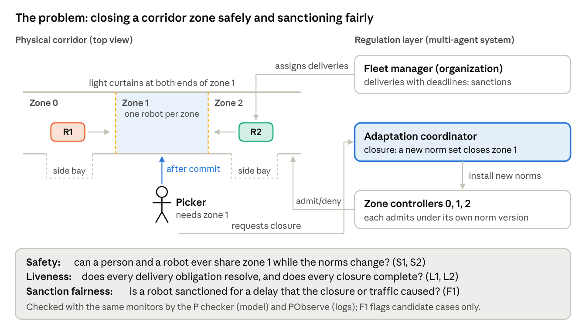

*Figure 1 · MAOP dimensions and JaCaMo technologies, with the fleet's components*

The physical layer lies outside the MAS. The environment dimension is the interface between the two, which is why regimented safety norms are placed there.

**Open systems.** In an open MAS, the designer does not control the internal code of the agents. Robots may be supplied by different vendors, execute learned policies or be teleoperated. Consequently, correctness cannot rely on agent compliance: the regulation layer must maintain its guarantees under *any* agent behavior. Section 7 models this assumption with nondeterministic agents.

**Robot fleets as MAS.** Warehouses, hospitals and factories operate fleets of autonomous mobile robots in spaces shared with people. Traffic is typically managed per zone, because a narrow aisle can accommodate only one robot, and zones are closed while people work in them. Each zone controller decides locally, and messages between controllers incur delays. The fleet therefore poses a *distributed* regulation problem: two controllers may temporarily disagree on which zones are closed.

### 2.1 Agent architectures and the BDI cycle

Agent architectures fall into three families:

- **Reactive** agents map percepts directly to actions. Brooks' subsumption architecture for robots is the classical example. Such agents respond quickly but do not plan.
- **Deliberative** agents maintain a symbolic model of the world and reason about goals before acting.
- **Hybrid** agents combine a reactive layer (e.g., obstacle avoidance) with a deliberative layer above it (e.g., route and task selection).

Most mobile robots follow a hybrid architecture, whereas JaCaMo agents are deliberative at the task level.

A BDI agent repeats a **reasoning cycle**:

1. **Perceive.** Read percepts (sensors, artifact properties) and messages, and update the *belief base*.
2. **Deliberate.** Choose which goals to pursue; the chosen ones become *intentions*.
3. **Select a plan.** From the plan library, pick a plan whose trigger matches the goal and whose context condition holds in the current beliefs.
4. **Act.** Execute one step of one intention: an action, a message, or a sub-goal. Then go back to 1.

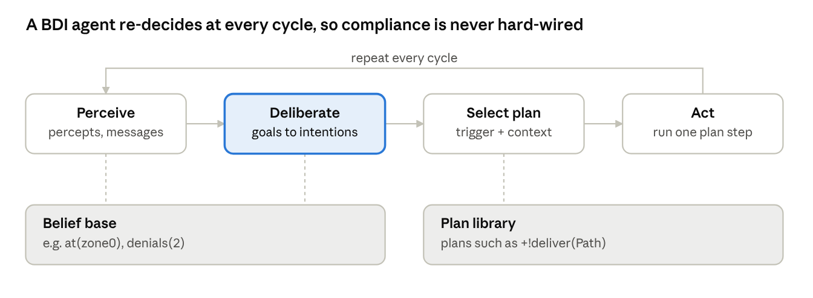

*Figure 2 · the BDI reasoning cycle*

A delivery robot in Jason (AgentSpeak), simplified:

```
// plan: <trigger> : <context> <- <body>.
+!deliver(Path) : not done(Path)
   <- !enter_next_zone(Path);
      !deliver(Path).

+!enter_next_zone(Path) : next_zone(Path, Z)
   <- requestAccess(Z).          // operation on the zone artifact; fails if denied

// failure handling: after 3 denials, park and give up the task
-!enter_next_zone(Path) : denials(N) & N >= 3
   <- park; .drop_intention(deliver(Path)).
-!enter_next_zone(Path)
   <- .wait(500); !enter_next_zone(Path).
```

The agent *chooses* whether to retry, park or report; this choice is the locus of its autonomy. The regulation layer can constrain only the outcomes of the agent's reasoning, not the reasoning itself.

### 2.2 Environment: artifacts

In CArtAgO, the environment is composed of **artifacts**: objects that agents use as tools. An artifact provides:

- **operations**: actions that agents can perform on the artifact;
- **observable properties**: state that agents perceive as beliefs;
- **signals**: transient events.

An operation can refuse to execute. That makes artifacts the natural place for *regimentation*: a prohibited action fails.

```java
// A zone controller as a CArtAgO artifact (sketch)
public class ZoneController extends Artifact {
  private int capacity;

  void init(int zone, int capacity) {
    this.capacity = capacity;
    defineObsProperty("occupancy", 0);
    defineObsProperty("closed", false);       // set by the norm set in force
  }

  @OPERATION void requestAccess() {
    ObsProperty occ = getObsProperty("occupancy");
    if (getObsProperty("closed").booleanValue() || occ.intValue() >= capacity) {
      failed("access denied");                  // regimentation: the action fails
    } else {
      occ.updateValue(occ.intValue() + 1);
    }
  }

  @OPERATION void release() {
    ObsProperty occ = getObsProperty("occupancy");
    occ.updateValue(occ.intValue() - 1);
  }
}
```

In a deployed fleet, the artifact would wrap a ROS 2 zone-controller node or a traffic server. The `ResourceGuard` machine described in section 7 is its P model.

### 2.3 Interaction

Agents communicate with an agent communication language (KQML, FIPA ACL). Each message carries a **performative** stating its intent: *inform*, *request*, *propose*, *accept*, *refuse*. In Jason, `.send(r2, tell, at(zone1))` informs and `.send(r2, achieve, wait)` asks for a goal.

Recurring exchanges are standardized as **protocols**. The **Contract Net** protocol is the classical protocol for task allocation: a manager announces a task, robots submit bids (e.g., based on their distance to the pickup point), and the manager awards the task. Approaches based on social commitments (Singh) assign a normative meaning to protocol steps; for instance, *"having accepted the task, the robot is committed to delivering it"*. This connects interaction to the norms discussed in section 3.

### 2.4 Organization: Moise

Moise describes an organization with three linked specifications:

| Specification | Describes | Fleet example |
| --- | --- | --- |
| Structural | roles, groups, links between roles, cardinalities | group `corridor_A` with role `courier` (max 2) and role `fleet_manager` (1) |
| Functional | global goals decomposed into **schemes** and **missions** | scheme `delivery`: goals `pick`, `traverse`, `drop`, `report`; mission `m_deliver` covers them |
| Normative | obligations and permissions linking roles to missions, with deadlines | *a `courier` is obliged to commit to `m_deliver` and achieve it within 5 ticks* |

A simplified normative specification:

```xml
<normative-specification>
  <norm id="n_deliver" type="obligation" role="courier"
        mission="m_deliver" time-constraint="5 minutes"/>
</normative-specification>
```

At run time, the organization is itself represented as an artifact. Agents adopt roles and commit to missions, and the normative engine of the organization (NPL, section 3) creates and tracks the resulting obligations.

### 2.5 Multi-robot coordination

Robot fleets face three classical coordination problems, each of which gives rise to norms:

- **Task allocation**, i.e., the assignment of deliveries to robots. Gerkey and Matarić (IJRR 2004) classify task-allocation problems by robot type (single- or multi-task), task type (single- or multi-robot) and timing (instantaneous or time-extended).
- **Path planning and traffic management.** Multi-agent path finding computes collision-free routes. Industrial fleets frequently rely on the simpler **zone reservation** scheme, in which a robot may enter a zone only while it holds a reservation for that zone. This scheme is adopted in this project.
- **Deadlock.** Two robots facing each other in a one-lane corridor, each holding its own zone and waiting for the other's, form a cyclic wait. Standard remedies include one-way lanes, priorities, timeouts with back-off (in this project, parking after three denials) and reservation of the entire corridor.

Each remedy can be expressed as a norm: "one direction at a time" is a prohibition, and "yield to the robot with priority" is an obligation. The project examines whether such norms interact safely with sanctions and zone closures.

## 3. Background: norms and normative MAS

Norms allow a MAS to steer autonomous agents without prescribing their internal behavior. They state what *ought* to happen and specify the consequences when it does not. A **normative MAS** is a MAS whose behavior is constrained by explicitly represented norms, about which agents can reason and which the system can monitor and enforce ([Boella, van der Torre and Verhagen](#references)).

**Deontic modalities.** A regulative norm usually takes one of the following forms:

- **Obligation** O(φ): the agent is required to bring about φ, typically before a deadline. *"The robot assigned delivery d must report it before tick 5."*
- **Prohibition** F(φ): the agent is required not to bring about φ. *"No robot may be in a zone while a person is inside."*
- **Permission** P(φ): φ is allowed, often as an exception to a prohibition.

Norms are usually *conditional*: they comprise an activation condition, a deontic content, a deadline or expiration condition, and a sanction. Their lifecycle proceeds from inactive to active, and then either to fulfilled or to violated and subsequently sanctioned.

**Regulative and constitutive norms.** Regulative norms constrain behavior ("must", "must not"). Constitutive norms define what *counts as* what within the institution, e.g., *"a person detected by the zone 1 light curtain counts as a human in zone 1"*. The adaptation model adopted in this project relies on both kinds (section 4).

**Enforcement mechanisms.** Two mechanisms are distinguished:

| Mechanism | Principle | Guarantee | Cost | In this project |
| --- | --- | --- | --- | --- |
| Regimentation | the violation is made impossible: the environment refuses the action | the norm holds invariantly | removes autonomy; applicable only to actions controlled by the environment | each zone controller refuses entry to a closed or occupied zone |
| Sanctioning (regulation) | the violation is permitted, detected and followed by a sanction | the norm holds only to the extent that sanctions deter violations | requires monitoring and a fair sanction policy | a missed delivery deadline results in a sanction |

Safety-critical norms (people and robots in the same zone) should be regimented, whereas performance norms (deadlines) are normally sanctioned. [Alechina, Bulling, Dastani and Logan (AAMAS 2015)](https://nottingham-repository.worktribe.com/output/752739) show that not every norm can be enforced by a guard, which is why the distinction is significant.

**Fairness of sanctions.** A sanction is justified only if the agent could have complied. In a fleet, regimentation itself can render compliance impossible: a robot denied entry to a closed zone, or obstructed by another robot in a one-lane corridor, misses its deadline through no fault of its own. Sanctioning such a robot penalizes side effects of the regulation itself and distorts any reputation or incentive scheme built on sanctions.

This project formulates fairness as a verifiable property: *an agent is sanctioned only for its own non-compliance, never for being blocked*. [Dell'Anna, Dastani and Dalpiaz](https://webspace.science.uu.nl/~dalpi001/papers/dell-dast-dalp-20-jaamas.pdf) study the run-time revision of sanctions that prove ineffective. The present project addresses a different question: the detection of unfairness that is inherent in the design.

**Norms in JaCaMo.** Moise organizations are compiled into programs of the Normative Programming Language (NPL). An NPL engine creates obligations when agents adopt roles and commit to missions, tracks their deadlines and reports violations to the organization.

**Verification of norms.** Previous work has applied model checking to norms, for example:

- ORWELL + MCAPL ([Dennis et al.](https://personalpages.manchester.ac.uk/staff/louise.dennis/pubs/climaX.pdf))
- CÒIR in Maude ([Gasparini et al.](https://abdn.elsevierpure.com/en/publications/c%C3%B2ir-verifying-normative-specifications-of-complex-systems))
- norm enforcement as supervisory control ([Dastani, Sardina and Yazdanpanah](https://research.utwente.nl/en/publications/norm-enforcement-as-supervisory-control/))

These approaches predominantly verify a normative *specification*. The present project instead verifies the *regulation machinery*: the concurrent components that monitor, enforce and modify the norms.

### 3.1 Anatomy of a norm

A conditional norm can be represented as a tuple of six components. The following table decomposes the delivery obligation of this project accordingly:

| Part | Meaning | Fleet example |
| --- | --- | --- |
| Addressee | who the norm binds (an agent or a role) | the robot playing `courier` for delivery d |
| Activation | when an instance of the norm starts | the fleet manager assigns d |
| Modality | obligation, prohibition or permission | obligation |
| Content | the state or action concerned | d is reported as delivered |
| Deadline | when the content must hold | tick of assignment + 5 |
| Sanction | what follows a violation (or reward for compliance) | a penalty recorded against the robot |

The norm is a template: each assignment creates a new **norm instance** with its own deadline. The `ObligationManager` described in section 7 maintains one record per instance.

### 3.2 Deontic logic in brief

Standard deontic logic (SDL) is a modal logic with the operators O (obligatory), P (permitted) and F (forbidden). The operators are interdefinable, and axiom D states that an obligation implies a permission, so that no agent is obliged to bring about the impossible:

```latex
P(\varphi) \equiv \neg O(\neg\varphi) \qquad F(\varphi) \equiv O(\neg\varphi) \qquad O(\varphi) \rightarrow P(\varphi)
```

SDL has well-documented limitations. The most prominent concerns **contrary-to-duty** reasoning, i.e., reasoning about what is obligatory *after* a violation. An example is *"a robot must not enter a closed zone; if it does, it must stop and report"*. Chisholm's paradox demonstrates that SDL cannot represent such norms adequately.

For this reason, normative MAS usually treat norms *operationally*, as objects with a lifecycle (section 3.3) that are evaluated against the observed behavior of the system. P models norms in the same manner.

#### Deontic logic seen from temporal logic

For readers familiar with temporal logics such as LTL and CTL, the semantics of deontic logic follows a similar intuition. All three are *normal modal logics*: each has a box operator, its dual diamond operator, and a semantics given by Kripke structures. In each, the box distributes over implication (axiom K), and every theorem may be prefixed with a box (the necessitation rule). The logics differ in the interpretation of the accessibility relation (Figure 3). In temporal logic, the relation links a point of a run to its successors; in deontic logic, it links a world to its *ideal alternatives*, i.e., the worlds in which every norm is respected.


*Figure 3 · the box of temporal logic and the box of deontic logic*

|  | Temporal logic (LTL / CTL) | Deontic logic (SDL) |
| --- | --- | --- |
| Box | G φ: φ at every future point (AG: on every run) | O φ: φ in every ideal world |
| Diamond | F φ = ¬G¬φ: φ at some future point | P φ = ¬O¬φ: φ in some ideal world |
| Box of a negation | G ¬φ: φ never happens | Forb φ = O ¬φ: φ is forbidden |
| Accessibility | "later than", along a run | "ideal alternative of" |
| Characteristic axiom | T (reflexivity): G φ → φ | D (seriality): O φ → P φ |
| What ¬φ in the current state means | G φ is false: a counterexample | nothing wrong with the logic: O φ ∧ ¬φ is consistent |

A note on notation: the symbol F denotes *eventually* in temporal logic and *forbidden* in deontic logic. To avoid ambiguity, this document writes Forb for the deontic operator.

The last two rows of the table express the essential difference. The temporal operator G is reflexive: if φ holds at every point, it holds at the current one, so a single state satisfying ¬φ refutes G φ. The deontic operator O is *not* reflexive: the set of ideal worlds need not contain the actual world, so the statements "the parcel ought to be delivered" and "the parcel was not delivered" are jointly consistent. This property is essential for a normative system, in which a violation is neither a contradiction nor an error but a state that the system must be able to represent and to which it must respond. Axiom D requires only that every world have at least one ideal alternative; it excludes conflicting obligations (O φ ∧ O ¬φ) and nothing else. Conflicting obligations are a practical concern in a fleet, for instance when a delivery deadline can be met only through a zone that has recently been closed.

#### The Andersonian reduction

[Anderson (1958)](https://doi.org/10.1093/mind/LXVII.265.100) showed that deontic logic can be reduced to an ordinary (alethic) modal logic plus one propositional constant V, read "a violation has occurred":

```latex
O\varphi \equiv \Box(\neg\varphi \rightarrow V) \qquad
P\varphi \equiv \Diamond(\varphi \wedge \neg V) \qquad
\mathit{Forb}\,\varphi \equiv \Box(\varphi \rightarrow V)
```

[Meyer (1988)](https://doi.org/10.1305/ndjfl/1093637776) applied the same idea to actions within the framework of dynamic logic: an action α is forbidden if every execution of α leads to a violation, \[α\]V, and permitted if some execution of α does not, ⟨α⟩¬V. Entering a closed zone is a forbidden action in this sense.

This reduction underlies the approach of the project. If violations are made observable events and the box is interpreted temporally, every norm becomes an ordinary temporal property *about violations*. The monitors of section 3.4 are constructed in this way: none of them uses a deontic operator, and each refers to fulfillment, violation or sanction events.

#### Deontic and temporal readings of a trace

The reduction also clarifies *whose* behavior a given property specifies (Figure 4).


*Figure 4 · one trace read deontically (robots) and temporally (regulator)*

- **For the robots, norms are deontic.** A robot may miss a deadline. The specification must therefore not reject such a trace; instead, it must determine the consequences. Requiring G ¬V would be inappropriate, because it would convert every norm into a regimented constraint and eliminate the autonomy that characterizes an open MAS.
- **For the regulator, properties are temporal.** The regulator must sanction every violation exactly once, must never admit a robot to a zone that the committed norm set closes, and must complete every adaptation. These are G and F properties that must hold on every run; a run that violates them reveals a defect.

Accordingly, the P monitors never assert that robots behave correctly. They assert that the *regulation* behaves correctly, irrespective of the robots' behavior: S1 to S3 and R3 address regimented norms, which the regulator can enforce by blocking; L1 and R1 address sanctioned norms, to which the regulator must respond; and F1 addresses the fairness of these responses.

#### Kinds of norms as temporal patterns

Once violations are represented as events, each kind of norm corresponds to a characteristic temporal pattern. The following table illustrates these patterns with the norms of the fleet.

| Kind of norm | Example in the fleet | Violation V occurs when | What the regulator must guarantee |
| --- | --- | --- | --- |
| Achievement obligation with a deadline | deliver the parcel by tick d | tick d passes without delivery | G(created → F(fulfilled ∨ sanctioned)), L1; bounded at run time, R1 |
| Maintenance obligation | keep zone 1 free of robots while it is closed | a robot is admitted while it is closed | regimented: G(closed → ¬admitted), S2 |
| Prohibition | no robot in a zone with the picker | both are in the zone | regimented: G ¬(robot in zone ∧ picker in zone), S1 |
| Contrary-to-duty obligation | if a robot is in a zone with the picker, it must stop | the prohibition above is violated | G(V → X protective stop): a property of the *reaction* |
| Permission | a robot may enter an open, free zone | never: a permission cannot be violated | AG(request ∧ open ∧ free → EF granted): branching, not a trace property |

Two rows of the table require further discussion.

- **Contrary-to-duty norms become straightforward to express.** Chisholm's paradox arises in SDL because SDL represents neither time nor violations explicitly. When V is an event, the secondary obligation is triggered by that event. Temporal deontic logics with deadlines avoid the paradox by the same means.
- **Permission is not a trace property.** The statement "a robot *may* enter" asserts that some admissible continuation allows the robot to enter. A single run in which the robot did not enter provides no evidence against it, since another robot may have occupied the zone first. In CTL, this corresponds to an EF property quantified over all possible futures; consequently, neither a single-trace monitor nor PObserve can check it. The P checker can approximate it by a liveness property under fairness: every request to an open zone is eventually granted. The corridor deadlock demonstrates that this approximation can fail even when no norm forbids entry, which relates permissions to section 6. The report should state which of the fleet's norms become safety, liveness or branching properties.

#### Two further paradoxes

- **Ross's paradox.** From O(deliver the parcel), SDL derives O(deliver the parcel ∨ drop it in the corridor), because the box operator is closed under logical consequence. In LTL, the analogous inference G φ → G(φ ∨ ψ) is unproblematic; for obligations, however, it is counterintuitive, since dropping the parcel would appear to discharge the obligation.
- **Free-choice permission.** The statement "a robot may take corridor A or corridor B" should entail "a robot may take corridor A", yet P(φ ∨ ψ) → P φ is not valid in SDL.

These paradoxes motivate the decision of this project to specify norms *operationally*, as machines that create, fulfill and violate norm instances, and to verify them with temporal monitors rather than by reasoning in SDL. The [Stanford Encyclopedia entry on deontic logic](https://plato.stanford.edu/entries/logic-deontic/) gives a broader survey.

### 3.3 Lifecycle of a norm instance

Each norm instance evolves according to a small state machine. The monitors of section 7 observe its transitions through the P events indicated under each state.

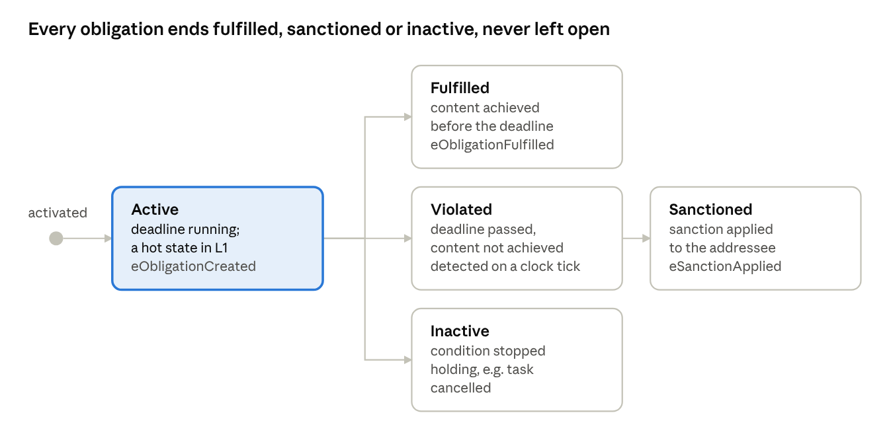

*Figure 5 · lifecycle of an obligation instance, with the P events that mark each state*

An instance that remains **Active** indefinitely constitutes the failure detected by the liveness property L1. A transition from **Violated** to **Sanctioned** for a robot that could not have complied constitutes the failure detected by the fairness property F1.

### 3.4 Norms as temporal properties

For verification with a model checker, each kind of norm is expressed as a temporal-logic property (G = always, F = eventually). The class of the property determines how it is checked in P:

| Norm kind | Temporal property | Property class | P construct | Checked at run time? |
| --- | --- | --- | --- | --- |
| Prohibition: *never two robots in a zone* | G ¬(occupancy > 1) | safety | `assert` in a spec | yes (PObserve) |
| Obligation without deadline: *every delivery is eventually resolved* | G(assigned → F resolved) | liveness | `hot` state in a spec | no: a finite log cannot show "never" |
| Obligation with deadline d | G(assigned → F≤d resolved) | bounded response (a safety property over time) | `assert` when the clock passes d | yes (PObserve) |
| Permission | none on its own | — | only as an exception inside a prohibition's monitor | — |

In an open system, the regulation cannot guarantee that every obligation is *fulfilled*; it can guarantee only that every obligation is *resolved*, either by fulfillment or by sanction. The property checked is therefore:

```latex
\mathbf{G}\big(\mathit{assigned}(r,d) \rightarrow \mathbf{F}_{\le 5}\,(\mathit{reported}(r,d) \lor \mathit{sanctioned}(r,d))\big)
```

### 3.5 Normative programming in JaCaMo: NPL

The Normative Programming Language (NPL) of Hübner, Boissier and Bordini expresses norms as rules, each consisting of a condition and a deontic consequence with a deadline. A simplified NPL-style rule for the delivery obligation is shown below:

```
norm n_deliver:
     play(R, courier, corridor_A) & assigned(R, D)
  -> obligation(R, n_deliver, delivered(D), `now` + `5 minutes`).
```

The NPL engine maintains each obligation instance in one of four states:

- **active**: the condition holds and the deadline has not been reached;
- **fulfilled**: the content was achieved before the deadline;
- **unfulfilled**: the deadline passed without the content being achieved, i.e., the obligation was violated;
- **inactive**: the condition ceased to hold.

The organization responds to unfulfilled obligations, typically by applying a sanction. [Yan et al.](https://hal-lara.archives-ouvertes.fr/ISCOD-ENSMSE/hal-05350751v1) extend NPL(s) and the SAI engine to support the adaptation of regulations (section 4).

### 3.6 Constitutive rules: Situated Artificial Institutions

Norms refer to *institutional* facts ("a person is in zone 1", "robot 2 entered zone 1"), whereas the system observes *physical* facts ("light curtain 1 is interrupted", "robot 2 crossed marker M7"). **Constitutive rules** relate the two. In Situated Artificial Institutions (SAI; de Brito, Hübner and Boissier), they take the form *X count-as Y when C*:

- *light curtain 1 interrupted* **count-as** *a person in zone 1*
- *a message `close(zone1)` from an agent playing `picker`* **count-as** *a detect-fact for closing zone 1*

This layer is relevant to verification: if a count-as rule is incorrect, the regulation acts on incorrect facts even when every other component is correct. In this project, the count-as layer appears at two points:

- in the model, where the `announce` statements determine which events constitute institutional facts;
- at run time, in the PObserve **log parser**, which translates log lines into those facts.

The parser is therefore part of the system that must be validated.

### 3.7 Sanctions

Sanctions may be of the following types:

- **material**: a fine or the loss of a reward;
- **reputational**: a reduction of a trust score;
- **access-based**: a lower priority in task allocation or zone reservation.

Sanctions may be applied by the organization, by peers or by the environment. Sanction policies should be *proportional* and *fair*, i.e., they should penalize only behavior that the agent could have avoided (section 3, fairness of sanctions). In a fleet, access-based sanctions feed back into traffic: a robot whose priority has been lowered waits longer and is therefore more likely to miss its next deadline, so that an unfair sanction can induce further sanctions.

### 3.8 Choosing an enforcement mechanism

The appropriate enforcement mechanism for a norm depends on two factors: the cost of a single violation, and whether the environment can physically prevent the forbidden action. Figure 6 positions the norms of the fleet along these two dimensions.


*Figure 6 · the norms of the fleet placed by cost and controllability*

- **High cost, preventable: regimentation.** A zone controller can refuse entry to a robot, and a collision, or an encounter between a robot and the picker, is unacceptable. Zone capacity and zone closures are therefore regimented.
- **High cost, not preventable: monitoring complemented by a safety layer.** The MAS cannot prevent a person from walking into a zone. The norm "the picker enters only a closed zone" can therefore only be monitored (property R3), and the actual guarantee must be provided by a layer below the MAS, such as a badge gate, a light curtain, or the robots' safety-rated speed and separation monitoring.
- **Low cost, not preventable: sanctioning.** A late delivery affects throughput, not safety. The robots' autonomy to reroute or reorder tasks outweighs the benefit of strict control.
- **Low cost, preventable: a design decision.** Parking after three denials may either be enforced by the zone controller or left to the robot and sanctioned when disregarded.

The figure also indicates where verification is most critical. A regimented norm must hold in every interleaving, which is precisely the space the P checker explores. A sanctioned norm need only be resolved, by fulfillment or sanction; this is a liveness requirement and, in the fleet, also a fairness requirement.

### 3.9 Conditions for a fair sanction

A sanction is intended to influence behavior by signaling to the agent that its choice was incorrect. This function presupposes that the agent could have chosen otherwise. A robot that missed its deadline because the regulator closed its route, or because another robot occupied the next zone, did not act wrongly. Sanctioning such a robot penalizes side effects of the regulation itself, and a learning robot may infer an inappropriate policy, for example avoiding all tasks that traverse zone 1.


*Figure 7 · when a missed deadline deserves a sanction*

Figure 7 formalizes this principle as a decision rule. Before applying a sanction, the organization determines whether the delay was caused by a regulator or by traffic. Only if neither is the case is the delay attributed to the robot.

Two observations indicate that this is more than a matter of policy detail:

- **The required information resides in another dimension.** Denials are known to the zone controllers (environment), whereas deadlines and sanctions belong to the organization. A fair sanction requires both kinds of information; fairness is therefore a cross-dimension property, of the kind that the unified view classifies but does not verify.
- **Safety and fairness are independent.** The two-phase protocol renders the closure safe, yet the starter kit still sanctions blocked robots. Property F1 is therefore expected to fail under both protocols. The remedy lies within the organization: deadlines are suspended while the regulation blocks an agent, after which F1 is checked again.

## 4. Background: regulation management in MAS

Regulation management balances the autonomy of the agents against control over the system as a whole. It encompasses how regulations are represented, monitored, enforced and modified at run time. [Yan, Nardin, Boissier and Sichman](https://hal-emse.ccsd.cnrs.fr/emse-05162306v1) propose a **unified view** that characterizes any design along three perspectives, and they use the resulting grid to classify existing MAS frameworks.

| Perspective | Options | This project (fleet) |
| --- | --- | --- |
| Regulation capabilities | what the regulation layer can do; operationalized here as *represent, monitor, enforce (regiment or sanction), adapt* | all four |
| MAOP dimension | agent-, environment-, interaction-, organization-centric, or hybrid (several at once) | **hybrid**: environment (zone controllers) + organization (fleet manager, closures) + agent (robots decide to park and give up) |
| Architectural style | centralized vs. decentralized / distributed regulators | **distributed**: one controller per zone, coordinated only by messages |

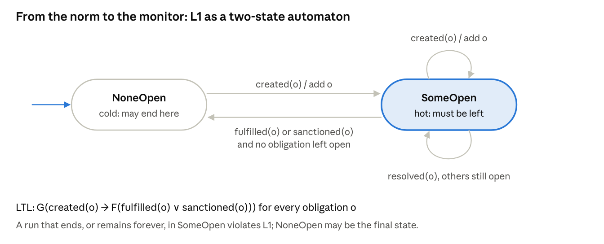

*Figure 8 · the fleet placed in the unified-view grid*

Because the COINE 2025 paper is not openly available, the student verifies its exact list of capabilities during the first week and adjusts the mapping in section 7 accordingly.

**Regulation adaptation.** Regulations change at run time, for example when a picker requires an aisle, a zone is flooded or a robot breaks down in a lane. [Yan et al. (ECAI 2025)](https://hal-lara.archives-ouvertes.fr/ISCOD-ENSMSE/hal-05350751v1) propose a general adaptation model with three capabilities, each of which produces a fact:

1. **Detect**: recognize a change that requires new regulation (producing a *detect-fact*).
2. **Design**: determine the new regulation (producing a *design-fact*).
3. **Execute**: install the new regulation in the running system (producing an *execute-fact*).

Constitutive and regulative norms determine who may perform each step and under which conditions. The authors implement the model by extending the SAI and NPL(s) normative engines within JaCaMo.

**Challenges of the distributed style.** With a single regulator, executing an adaptation amounts to one local update. With one regulator per zone, the update must reach every controller. Messages arrive in an arbitrary order, and agents continue to act while messages are in transit. During this interval, controllers may disagree, and a robot may be admitted under the superseded rules. Two-phase commit, a protocol from distributed databases, eliminates this interval:

- **Prepare.** The affected controllers stop admitting robots and drain the zone.
- **Commit.** The new norm set takes effect only after every controller has acknowledged.

The protocol, however, introduces a new risk: draining presupposes that robots are *able* to leave, and in a one-lane corridor they may obstruct one another.

**Research gap addressed.** The unified view is a *classification*: it describes where regulation resides, not whether a given design is correct. Interactions among distributed regulators, physical constraints and sanctions can be identified only by exploring message interleavings, which is the subject of section 5.

### 4.1 The capabilities in detail

Each capability corresponds to a design question, and different designs may realize the same capability in substantially different ways.

| Capability | Question it answers | Design options | In this fleet |
| --- | --- | --- | --- |
| Represent | Where and how are the norms written down? | implicit in agent or controller code; explicit declarative norms (NPL); versioned norm sets | a versioned norm set: the set of closed zones, plus delivery obligations in the fleet manager |
| Monitor | Who observes what, and is it enough to detect a violation? | agents monitor themselves; artifacts observe actions on them; the organization collects reports | zone controllers observe entries and exits; the fleet manager observes reports and the clock |
| Enforce | What happens to a violation? | regimentation (it cannot happen) or sanctioning (it is detected and punished) | regimented zone capacity and closures; sanctioned deadlines |
| Adapt | How do the norms change at run time, and who may change them? | detect, design and execute steps, each run by an agent, an artifact or the organization | the picker detects; the coordinator designs and executes; the zone controllers install |

**Observability.** A norm can be monitored only if its content is observable. The norm *"no robot in a zone with a person"* requires both robot positions and person detection. If the light curtain of zone 1 fails, the regulation cannot detect the person and ceases to protect them without any indication. Run-time monitoring with PObserve evaluates what the logs record and therefore inherits the same blind spots.

### 4.2 The MAOP views, with examples

The unified view locates regulation along the four MAOP dimensions. The examples below are representative systems for each view; they reflect the interpretation adopted in this specification rather than the classification of the paper, which the student verifies during the first week.

| View | Regulation is represented and managed by… | Typical mechanism | Strength | Weakness |
| --- | --- | --- | --- | --- |
| Agent-centric | the agents themselves | norm-aware BDI agents that reason about obligations and choose to comply | full autonomy; no central component | relies on agents being honest and correct |
| Environment-centric | artifacts in the environment | CArtAgO artifacts or smart controllers that refuse forbidden actions | strong guarantees (regimentation) | only for actions that pass through an artifact |
| Interaction-centric | the protocols agents use to communicate | electronic institutions whose governors filter messages; commitment protocols | catches violations in communication | blind to physical actions |
| Organization-centric | an organizational infrastructure | Moise roles and missions with an NPL engine | explicit, inspectable norms | needs reliable reports from agents and environment |
| Hybrid | several of the above together | e.g. organization for obligations + environment for safety | each norm enforced where it is cheapest and strongest | the parts must stay consistent with each other |

The fleet follows the hybrid view. Safety norms reside in the environment (zone controllers), performance norms in the organization (fleet manager), and part of the regulation in the agents (robots decide when to abandon a task). The consistency among these parts is the subject of this project.

### 4.3 Architectural styles

| Style | Structure | Advantages | Risks |
| --- | --- | --- | --- |
| Centralized | one regulator for the whole system | one consistent view; simple to verify | bottleneck and single point of failure; does not scale to large sites |
| Hierarchical | regulators per area under a supervisor | local decisions with global oversight | the supervisor still sees changes late |
| Distributed | several peer regulators, each owning part of the system | scales; local, fast decisions; no single point of failure | regulators can disagree during a change; needs a coordination protocol |

Warehouses with hundreds of robots typically require the distributed style. This project studies its smallest non-trivial instance: three zone controllers.

### 4.4 Adaptation as a control loop

The detect–design–execute model of [Yan et al.](https://hal-lara.archives-ouvertes.fr/ISCOD-ENSMSE/hal-05350751v1) is analogous to the **MAPE-K loop** of autonomic computing (Kephart and Chess, 2003), which comprises the steps Monitor, Analyze, Plan and Execute over shared Knowledge:

| MAPE-K step | Adaptation capability | Fleet example |
| --- | --- | --- |
| Monitor + Analyze | detect | the picker's request is recognized as a need to close zone 1 |
| Plan | design | the coordinator computes norm set v + 1 with zone 1 closed |
| Execute | execute | the zone controllers install v + 1 |
| Knowledge | the norm sets and the organization's state | current version, closed zones, open obligations |

The two models differ in one significant respect: in a normative MAS, the adaptation loop is **itself regulated**. Constitutive norms define which facts count as a valid trigger, and regulative norms define who may perform each step, e.g., *only an agent playing `picker` or `safety_officer` may request a closure*. An unauthorized closure request therefore constitutes a violation in its own right.

### 4.5 Consistency during a regulation change

The **transition window** is the interval between the decision to change the norms and the moment at which every regulator applies the change. Three hazards arise within it:

1. **Stale admission.** A controller still operating under the previous norm set admits a robot into a zone that the new set closes (property S2).
2. **Premature entry.** The person enters before the zone has been drained (properties S1 and R3).
3. **Lost or reordered updates.** Two adaptations overlap, and controllers apply them in different orders. Version numbers and the serialization of adaptations in the coordinator prevent this hazard.

The remedy adopted from distributed databases is **two-phase commit**, which guarantees that either all regulators switch to the new norm set or none does; in this project, it is extended with a drain step. The protocol has a known cost: a participant that cannot complete its prepare phase blocks all others. In the fleet, this participant is the zone 1 controller waiting for a robot that cannot leave because the next zone is held by another robot. Whether such blocking can occur is the subject of liveness property L2.

### 4.6 The inconsistency window

With one controller per zone, there is no single instant at which the rules change: each controller learns of the new norm set when the corresponding message arrives. Figure 9 depicts the versions held by each controller over time.

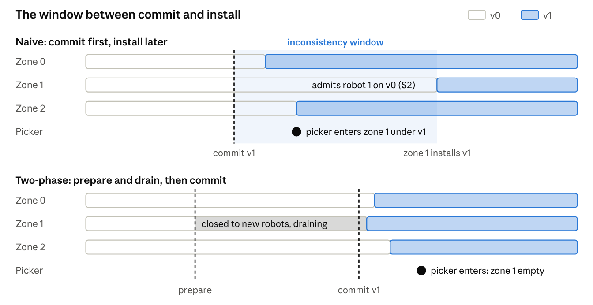

*Figure 9 · versions of the norm set in each zone controller over time*

- **Naive protocol (top).** The coordinator commits v1 and informs the picker that the zone is closed. Zones 0 and 2 install v1 promptly, whereas the message to zone 1 is delayed. During the shaded interval, zone 1 still operates under v0 and admits robot 1, while the picker already acts under v1. Consequently, both S1 and S2 can be violated.
- **Two-phase protocol (bottom).** Zone 1 stops admitting robots at *prepare* and drains. The commit occurs only after the zone is empty. The zones still install v1 at slightly different times, so an interval of inconsistency remains; within it, however, no behavior depends on the difference, because zone 1 is closed to robots under both versions.

This observation extends beyond the corridor considered here. In a distributed regulator, a change of norms is not an assignment but a protocol. Its correctness must be established over all possible message delays, which is why it is verified with a model checker rather than by inspection of the norm sets.

## 5. Background: the P language and PObserve

P models a system as a collection of **state machines that communicate through asynchronous events**. Its checker explores alternative orderings of these events in search of an ordering that violates a property. P was developed at Microsoft Research ([Desai et al., PLDI 2013](https://www.microsoft.com/en-us/research/publication/p-safe-asynchronous-event-driven-programming-2/)) and is used at AWS for services such as S3, DynamoDB and EC2.

P has also been applied in robotics. SOTER ([Desai et al.](https://arxiv.org/pdf/1808.07921)) builds runtime-assured robot software on P, and [SOTER on ROS](https://escholarship.org/uc/item/5r78g42p) ports it to the Robot Operating System. A fleet with one controller per zone belongs to the class of asynchronous systems that P is designed to analyze.

**Core concepts:**

| Concept | P syntax | Meaning |
| --- | --- | --- |
| Event | `event eAccessRequest: tAccess;` | a typed message |
| Machine | `machine Robot { … }` | an actor with local variables and an input queue |
| State and handler | `state Moving { on eAccessDenied do (z: int) { … } }` | how the machine reacts to an event in a state |
| Send | `send guards[next], eAccessRequest, (agent = id, …);` | asynchronous message to another machine |
| Defer / ignore | `defer eX;` / `ignore eX;` | keep the event for later / drop it in this state |
| Nondeterminism | `if ($) { … }` | the checker tries both branches: models robots that may not report |
| Monitor (spec) | `spec S observes eA, eB { … }` | a global observer that asserts properties |
| Announce | `announce eTaskAbandoned, (agent = id, where = z);` | notify monitors without sending to any machine |
| Hot / cold state | `hot state InProgress { … }` | liveness: an execution must not stay in a hot state forever |
| Test case | `test tc [main=Test]: assert S in { … };` | a closed system plus the monitors to check |

The fairness monitor of this project illustrates how a normative property is expressed as a P specification:

```
type tAbandon = (agent: int, where: int);
event eTaskAbandoned: tAbandon;

spec SanctionsReflectMisconduct observes eTaskAbandoned, eSanctionApplied {
  var blocked: set[int];
  start state Watching {
    on eTaskAbandoned do (a: tAbandon) { blocked += (a.agent); }
    on eSanctionApplied do (o: tOutcome) {
      assert !(o.agent in blocked),
        format("robot {0} sanctioned although it was blocked", o.agent);
    }
  }
}
```

**Checking.** The command `p compile` builds the project, and `p check -tc <test> -s 10000` executes 10,000 schedules of the given test case. A failed assertion produces a trace under `PCheckerOutput/BugFinding/`, which can be replayed with the corresponding seed. The checker is a bug-finding tool: it explores a large number of schedules but does not establish correctness for arbitrary fleet sizes.

**Modules and refinement.** [Desai's ModP work](https://www2.eecs.berkeley.edu/Pubs/TechRpts/2020/EECS-2020-3.pdf) introduces a module system for compositional, assume–guarantee reasoning, with which it can be shown that a composition of modules refines an abstract specification. This capability underlies research question 3. Before these features are relied upon, it must be determined which of them the current P release supports.

**PObserve: the same monitors at run time.** PObserve checks logs of a deployed system against P specifications. The procedure is as follows:

1. `p compile --mode pobserve` compiles the monitors (without the model machines) into Java classes: `PEvents`, `PTypes` and `PMachines`.
2. A Java **log parser** translates each log line into a P event together with a partition key (here, the site or warehouse).
3. The PObserve command-line interface (`java -jar PObserve-1.0.0.jar --jars <package> --spec <Monitor> -l <log>`) or its JUnit integration replays the events through the monitor.
4. PObserve reports the first violation together with a replay of the events that led to it.

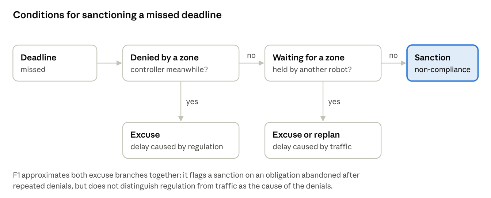

*Figure 10 · design-time and run-time checking share one set of monitors*

Design-time and run-time checks therefore share a single definition of correctness. Because PObserve orders events by timestamp within a key, logs from several fleet nodes require synchronized clocks (NTP or PTP).

PObserve reports assertion failures but does not report hot states that remain open at the end of a finite log. Liveness properties are therefore reformulated as **bounded-response** properties for run-time checking.

**Scope of each check.** The checker and PObserve answer different questions, and neither can replace the other (Figure 11).

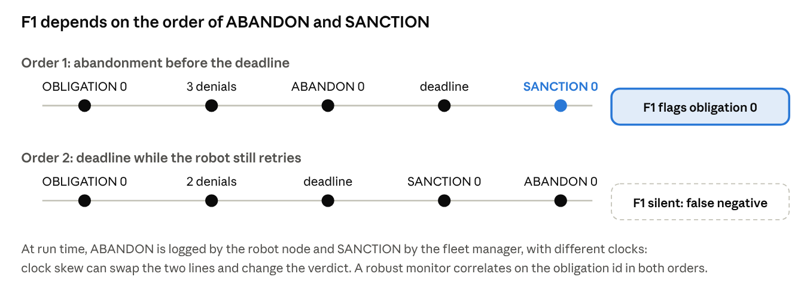

*Figure 11 · what the checker and PObserve can each establish*

- **The checker** explores many schedules, but only schedules of the model. A violation that it reports reflects the real system only to the extent that the model is faithful; a violation in the "model only" region is an artifact of abstraction, for example of robots moving between zones instantaneously. The absence of violations constitutes evidence about the design, bounded by the number of schedules explored.
- **PObserve** examines few executions, but real ones. A violation that it reports did occur, insofar as the log is accurate. It provides no information about executions that were not logged, nor about faults that the log cannot reflect, such as a localization error that places a robot in the wrong zone.
- **The intersection** is where the two methods meet: the same monitor, written once, evaluates both the design and the running fleet. A counterexample from the checker can serve as a test log, and a violation reported by PObserve can serve as a new test case for the model.

The region outside both sets motivates a safety layer below the MAS: no software check covers a failure that can be expressed neither in the model nor in the log.

### 5.1 Types and data

P is statically typed and provides the following types:

- **Primitive types:** `int`, `bool`, `float`, `string`, `machine` (a reference to a machine) and `event`.
- **Collections:** `seq[T]`, `set[T]`, `map[K, V]`.
- **Tuples:** named, e.g. `(agent: int, res: int, ver: int)`.
- **Enums and type aliases:** `type tNormSet = (ver: int, closed: set[int]);`.

Values are copied when sent, so machines share no memory. All coordination takes place through messages, which is both the source of the difficulty of distributed regulation and the dimension that the checker explores.

### 5.2 Machine lifecycle

```
machine ZoneController {
  var occupants: set[int];
  start state Init {
    entry (cfg: (zone: int, capacity: int)) {   // payload given to `new`
      goto Open;
    }
  }
  state Open {
    on eAccessRequest do (r: tAccess) { /* admit or deny */ }
    on eNormPrepare goto Draining;                // leave Open, enter Draining
    ignore eTick;                                 // explicitly not interested
  }
  state Draining {
    entry { /* stop admitting; ack when empty */ }
    defer eNormPrepare;                           // keep it queued for later
  }
}
```

- `new ZoneController((zone = 1, capacity = 1))` creates a machine and runs its start state's `entry` with the payload.
- `goto S` runs the current state's `exit`, then `S`'s `entry`.
- `raise e` handles an event immediately inside the same machine.
- `this` is the machine's own reference, used to receive replies.

### 5.3 Communication semantics

- `send m, e, payload;` is **asynchronous**: the sender continues immediately, and the event is appended to the single input queue of `m`.
- Events from one sender to one receiver are delivered in the order in which they were sent, whereas events from different senders may interleave in any order. The checker explores these interleavings.
- By default, messages are not lost. Failures, such as a crashed controller or a lost message, must be modeled explicitly, for example with a machine that may drop or delay messages using `$`.
- **Unhandled events are errors.** If a machine receives an event that its current state neither handles, defers nor ignores, the checker reports a bug. This rule exposes protocol gaps early, such as a controller receiving `eRelease` while draining. `defer` and `ignore` should therefore be introduced deliberately, and never merely to suppress a checker error.

### 5.4 Specification monitors

A `spec` machine is a global observer with the following characteristics:

- It declares the events that it `observes` and executes synchronously each time one of these events is sent or announced.
- It cannot send events; it can only update its own variables and evaluate `assert` statements.
- An execution may terminate in a **cold** state, whereas a **hot** state must eventually be exited. If a run remains in a hot state beyond the bound, the checker reports a liveness violation.
- `announce e, payload;` delivers an event to monitors only. Machines use it to publish institutional facts (an entry, a commit, a sanction) without sending them to another machine.

### 5.5 How the checker explores

The checker replaces the scheduler of the real system. At each step, it determines which machine executes next and how each `$` choice is resolved.

A single run up to a step bound is called a **schedule**, and the option `-s 10000` requests 10,000 schedules. Exploration strategies range from random choices to priority-based strategies designed to reach deep bugs with few context switches. Each reported bug is accompanied by the seed that reproduces it.

The search detects bugs but does not prove their absence. Models should therefore be kept small (two robots, three zones and a bounded clock) and enlarged only after the small model satisfies its properties.

**Why interleavings matter.** Failures in a concurrent system arise from particular orderings of events rather than from individual events. Consider three events of a naive closure of zone 1: robot 1 is admitted to zone 1 (A), the coordinator commits v1 (C), and zone 1's controller installs v1 (I). In the naive protocol, I always follows C, which leaves three possible orderings (Figure 12).


*Figure 12 · the orders of three closure events under the naive protocol*

Only one of these orderings is safe. If the robot is admitted before the commit, it is not drained, and the picker subsequently enters a zone that the robot occupies. If it is admitted between the commit and the installation, zone 1 applies a rule that has already been superseded. Neither failure results from a defect in an individual component, since each controller behaves as specified. Testing would reveal these failures only if message delays happened to align, which is rare in a laboratory setting but plausible in a heavily loaded warehouse network.

The checker enumerates these orderings systematically. The two-phase protocol does not make the unsafe orderings less likely; it eliminates them, because zone 1 refuses new robots and is emptied before the commit. A modification that only makes a race less frequent, such as a delay before the commit, leaves both unsafe branches in the tree.

### 5.6 Common pitfalls

- **Over-deterministic test drivers.** If a test always starts the picker after the robots, many bugs cannot manifest. Nondeterministic choices (`$`) and several drivers should be used to widen the set of reachable orderings.
- **Monitor timing.** A monitor observes an event when it is *sent*, before the receiver processes it. A clock tick is therefore visible to a monitor before the fleet manager has applied it. For this reason, the run-time deadline monitors (R1, R2) are not used in the checker.
- **Liveness and fairness.** Hot-state checks assume that every enabled machine is eventually scheduled. A reported violation caused solely by the indefinite starvation of a machine does not constitute a genuine bug.
- **Unbounded models.** An unbounded clock or retry loop yields unbounded schedules. Such loops must be bounded (`maxTicks`, a retry limit), and the bounds must be reported.

### 5.7 Mapping normative concepts to P

| Normative concept | P construct | Where in the starter kit |
| --- | --- | --- |
| Norm set (closed zones) | a versioned tuple `tNormSet` | `Common/MonitorEvents.p` |
| Regimented prohibition | admission check in a machine + `assert` in a monitor | `ResourceGuard.p`, `Specs.p` (S1) |
| Obligation instance | an entry in a `map` keyed by obligation id | `ObligationManager.p` |
| Deadline | logical clock events `eTick` | `Clock.p` |
| Violation and sanction | deadline check on each tick, then `eSanction` + `announce eSanctionApplied` | `ObligationManager.p` |
| Constitutive rule (count-as) | which `announce` a machine makes; at run time, the log parser | machines; `FleetRegulationParser.java` |
| Adaptation (detect, design, execute) | coordinator states and the prepare/ack/commit events | `AdaptationCoordinator.p` |
| Open agent | nondeterministic `$` choices | `Robot.p` |
| Fairness meta-norm | a monitor over `eTaskAbandoned` and `eSanctionApplied` | `PSpec/FleetSpecs.p` (F1) |

### 5.8 PObserve in more detail

- **Partition keys.** The parser assigns a key to each event. All events with the same key are delivered, in timestamp order, to a dedicated instance of the monitor. The key must be chosen such that every property depends only on the events of a single key. Here, the key is the site, because a closure involves all zones of a site.
- **Ordering.** Events that are out of timestamp order within a key are counted as errors. PObserve also retains a replay window of recent events (`--replay`) for reporting. The clocks of fleet nodes must be synchronized, and timestamps require microsecond precision.
- **Parser contract.** `apply(logLine)` returns a stream of zero or more events and an empty stream for lines that do not represent regulation events. The parser must not hold static mutable state, because PObserve executes parsers on several threads.
- **Generated classes.** `p compile --mode pobserve` names tuple classes after their abbreviated field names; for example, `(agent, res, ver)` becomes `PTuple_agent_res_ver`. The generated `PTypes.java` should be inspected before the parser is written.
- **Execution modes.** JUnit tests are suited to continuous integration on recorded logs, whereas the command-line interface is suited to on-demand checking of production logs.

**Learning path (days 1–7):**

- [ ] Install P and complete the official tutorials ([p-org.github.io/P](https://p-org.github.io/P/)) ClientServer and TwoPhaseCommit; the latter is directly relevant to this project.
- [ ] Study the PObserve documentation: [overview](https://p-org.github.io/P/advanced/pobserve/pobserve/), [log parser](https://p-org.github.io/P/advanced/pobserve/logparser/) and [command-line interface](https://p-org.github.io/P/advanced/pobserve/pobservecli/).
- [ ] Build and run the LockServer PObserve example in the P repository (`Src/PObserve/Examples/LockServerPObserve`).
- [ ] Read [Desai et al., PLDI 2013](https://www.microsoft.com/en-us/research/publication/p-safe-asynchronous-event-driven-programming-2/), sections 1–3, and the SOTER paper ([arXiv 1808.07921](https://arxiv.org/pdf/1808.07921)).

## 6. The system: robots in a shared corridor

Two mobile robots deliver goods through a one-lane corridor consisting of three zones (0, 1 and 2), each with capacity 1 and its own zone controller. Robot 1 travels 0 → 1 → 2 and robot 2 travels 2 → 1 → 0; their paths therefore meet head-on. A fleet manager assigns deliveries with deadlines. At unpredictable times, a human picker requires access to zone 1, which first necessitates a **zone closure**: a regulation adaptation that closes zone 1 to robots.


*Figure 13 · the corridor seen from above (illustrative)*

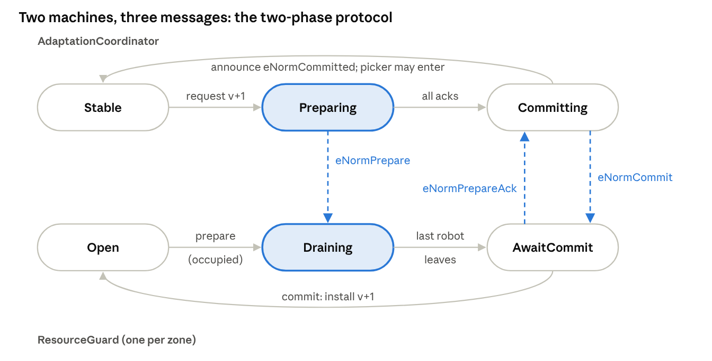

*Figure 14 · fleet architecture, components by MAOP dimension*

Because each zone controller decides independently, a closure is safe only if all three controllers switch norm sets before the picker enters. The project verifies the coordinator's protocol and the ability of the robots to drain zone 1.

**Normal operation:**

1. The fleet manager assigns a delivery, which creates an obligation with a deadline.
2. The robot requests entry from the controller of its next zone. It continues to occupy its current zone until entry is granted, because a robot cannot leave a zone instantaneously.
3. If the next zone is open and free, its controller admits the robot, which then releases the zone behind it.
4. After three denials, the robot parks in a side bay, releases its zone and abandons the delivery.
5. At the last zone, the robot leaves the corridor and reports completion. As an open-system agent, a robot may fail to report.
6. If the deadline passes without a report, the fleet manager sanctions the robot.

**Zone closure (regulation adaptation):**

1. **Detect.** The picker requests the closure.
2. **Design.** The regulation coordinator computes the next norm set: version + 1, with zone 1 closed.
3. **Execute.** The new norm set is installed in every zone controller, after which the picker is notified that entry is permitted.
4. Upon leaving, the picker requests the reverse adaptation, which reopens zone 1.

**Norms of the fleet:**

| Norm | Modality | Enforcement | Level |
| --- | --- | --- | --- |
| At most one robot per zone | prohibition | regimented by each zone controller | physical safety |
| No robot in a zone while a person is inside | prohibition | regimented by the zone controllers | physical safety |
| A person enters only after the closure is committed | obligation on the procedure | monitored | safety procedure |
| Report a delivery before its deadline | obligation with deadline | sanctioned by the fleet manager | performance |
| A delivery ends either fulfilled or sanctioned, never both | integrity of the organization | by construction, monitored | organizational |
| Sanction only an agent's own non-compliance | meta-norm on the sanction policy | monitored | fairness |

**Execution policies.** Two policies for executing a closure are compared:

- **Naive.** The coordinator declares the new norm set immediately, and each zone controller installs it upon receipt of the corresponding message.
- **Two-phase.** The coordinator sends *prepare*. Controllers whose zone is unaffected acknowledge immediately and continue to serve robots. The controller of the affected zone stops admitting robots, waits until the zone is empty and then acknowledges. The coordinator *commits* only after all controllers have acknowledged.


*Figure 15 · naive vs. two-phase zone closure, as message sequences*

In the naive sequence, the zone 1 controller still holds norm set v0 when the robot requests entry, because v1 is still in transit. The two-phase sequence cannot reach this state, since the picker is notified only after zone 1 has been drained and its controller has acknowledged.

The two central results expected from the project are a demonstration that the naive policy is unsafe and an analysis of why even the safe policy is unfair to robots.

**The two-phase protocol as state machines.** In the starter kit, the protocol is distributed over two P machines (Figure 16): the `AdaptationCoordinator` and one `ResourceGuard` per zone.

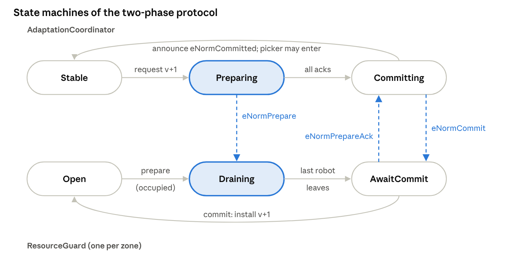

*Figure 16 · the two-phase protocol as two communicating state machines*

- **Prepare.** The coordinator sends `eNormPrepare` to every zone controller. The controller of zone 1, which the new norm set closes, enters `Draining`: it denies new robots but permits the current occupant to leave. Zones 0 and 2 are unaffected and acknowledge immediately, so they continue to serve robots throughout.
- **Acknowledge.** When zone 1 is empty, its controller sends `eNormPrepareAck` and continues to deny requests, because it cannot yet determine whether the commit has occurred.
- **Commit.** Once all acknowledgements have been received, the coordinator announces `eNormCommitted`, which the monitors observe and which permits the picker to enter. It then sends `eNormCommit`, upon which each controller installs the new version.

The highlighted states carry the safety argument. The figure also reveals the cost of the protocol: the coordinator remains in `Preparing` until zone 1 is empty, and in the corridor, emptying a zone is not always possible.

**Deadlock in the corridor.** A robot retains its zone until the next zone is granted. Consequently, two robots moving head-on may each hold the zone that the other requires (Figure 17). This configuration is an instance of the hold-and-wait cycle known from operating systems.

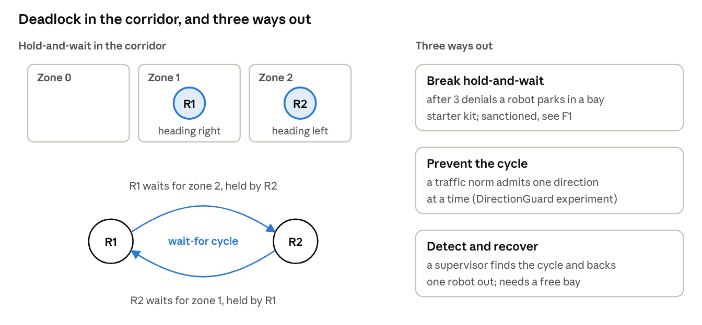

*Figure 17 · head-on robots form a wait-for cycle, and three ways to break it*

The cycle is relevant to regulation in two respects. First, it can block the closure: if robot 1 occupies zone 1 while waiting for zone 2, zone 1 is never drained and the adaptation never commits. Property L2 (`AdaptationCompletes`) detects this situation when parking is removed. Second, every resolution of the cycle has a normative cost:

- **Breaking hold-and-wait.** The robots of the starter kit abandon the task after three denials and park. This resolves the deadlock but leaves the task incomplete, and the robot is subsequently sanctioned for a delay that it did not cause (F1).
- **Preventing the cycle.** A traffic norm that admits only one direction of travel at a time renders the cycle impossible. It constitutes an additional regimented norm and reduces throughput.
- **Detection and recovery.** A supervisor detects the cycle and backs one robot out. This approach requires a free bay and introduces an additional component that must itself be verified.

A comparison of these remedies with the checker, with respect to both the closure properties and the fairness property, is one of the experiments of the project (section 7.3).

## 7. Technical specification

The deliverable is a P project consisting of three parts:

- a model of the fleet;
- a catalog of monitors checked against this model;
- a PObserve package that checks the same monitors against logs.

A starter kit containing draft versions of all three parts is provided (section 9). The project consists of bringing the kit to a compilable state, correcting it, justifying every modeling decision and extending it.

### 7.1 Model components

| P machine | Unified-view role | MAOP dimension | Responsibility |
| --- | --- | --- | --- |
| `Robot` (×2) | regulated agent | agent | requests the next zone, holds the current one, parks after 3 denials (announces `eTaskAbandoned`), reports or not (`$`) |
| `ResourceGuard` (×3) | regimentation | environment | one per zone; admits or denies by norm set and capacity; drains during prepare only if its zone changes |
| `ObligationManager` | sanctioning | organization | fleet manager: creates delivery obligations, checks deadlines on each tick, sanctions |
| `AdaptationCoordinator` | adaptation (detect → design → execute) | organization | versioned norm sets sent to all 3 controllers; two-phase or naive |
| `HumanRequester` | source of the detect-fact | environment (human) | the picker: requests the closure of zone 1, enters on commit, leaves, requests reopening |
| `Clock` | time | — | logical ticks; one final far-future tick so that every deadline passes |

### 7.2 Property catalog

| Id | Monitor | Kind | Checked by | Expected with two-phase / naive |
| --- | --- | --- | --- | --- |
| S1 | `RegimentationSafety`: never two robots in a zone; never a robot and a person together | safety | checker + PObserve | holds / **violated** |
| S2 | `NoStaleAdmission`: no admission to a zone the committed norm set closes; versions in order | safety | checker + PObserve | holds / **violated** |
| S3 | `NoDoubleOutcome`: a delivery is never both fulfilled and sanctioned | safety | checker + PObserve | holds / holds |
| L1 | `EveryObligationResolved`: every delivery eventually fulfilled or sanctioned | liveness (hot state) | checker | holds / holds |
| L2 | `AdaptationCompletes`: every closure eventually commits | liveness (hot state) | checker | holds / holds |
| R1 | `ObligationDeadlineRespected`: resolved within 1 tick of the deadline | bounded response | PObserve | holds / holds |
| R2 | `AdaptationBoundedTime`: commits within 5 ticks | bounded response | PObserve | holds / holds |
| R3 | `LockoutBeforeEntry`: a person enters only a closed zone | safety (procedure) | checker + PObserve | holds / holds |
| F1 | `SanctionsReflectMisconduct`: no sanction for a robot that was blocked | fairness | checker + PObserve | **violated** / **violated** |

The expected outcomes are **hypotheses** derived from the design. They are consistent with the output of a sample-log simulator but have not yet been confirmed with `p check`; confirming or refuting them is part of the project. F1 is *expected* to fail, and its counterexample would constitute a finding about the norms rather than a defect of the monitor.

### 7.3 Experiments (priorities in 7.5)

| # | Experiment | Change to the model | Question answered |
| --- | --- | --- | --- |
| E1 | Baseline, two-phase | none | Do S1–S3, L1, L2 and R3 hold under 10^5 schedules? |
| E2 | Baseline, naive | `twoPhase = false` | Which monitor fails first, and in which zone? The trace is explained step by step |
| E3 | Sanction fairness | test `tcFleetSanctionFairness` | Which situations cause unfair sanctions: the closure, the head-on conflict, or both? |
| E4 | Block every controller during prepare | remove the "unaffected controller acks at once" branch | Does draining now depend on parking? Does anything deadlock? |
| E5 | No parking | robots retry forever | Does hold-and-wait occur in the corridor, and does L2 fail when zone 1 must drain? |
| E6 | Traffic norm (remedy 1) | add a direction controller: one travel direction per corridor at a time | Does F1 then fail only because of closures? |
| E7 | Deadline suspension (remedy 2) | the fleet manager suspends a deadline while the regulation blocks the robot | Does F1 hold? At what cost to L1 and R1? |
| E8 | Scale | 3–4 robots or 4–5 zones | Checker run time; where does exploration stop scaling? |

**Stretch goal: refinement (research question 3).** An abstract centralized regulator is specified as a single machine holding the state of the entire corridor. It is then shown, either by refinement testing or by means of P's module system, that the three distributed controllers together with the coordinator behave as this regulator. Such a result would turn the architectural-style axis of the unified view into a verified claim.

### 7.4 Run-time part (PObserve)

**Log contract.** Each regulation event is recorded as one log line:

- `Site=fleet-A, Event=ENTER, Agent=1, Res=1, Ver=0`;
- in addition, `CONFIG` (all zones: `Capacity=0:1;1:1;2:1`), `TICK`, `OBLIGATION`, `FULFILLED`, `SANCTION`, `LEAVE`, `ADAPT_START`, `COMMIT`, `HUMAN_ENTER` and `HUMAN_LEAVE`;
- `ABANDON` (`Agent, Where`), emitted by a robot when it abandons its task.

Each line is prefixed with a UTC timestamp of microsecond precision. `Site` serves as the partition key.

**Package.** A Gradle project that runs `p compile --mode pobserve` on the monitors only, together with a Java parser, JUnit tests (for safety and fairness) and a script that invokes the command-line interface.

**Validation criteria:**

- the two-phase sample log satisfies every safety monitor;
- the naive sample log violates S1 and S2;
- both logs violate F1;
- R1 and R2 detect injected faults, namely a deleted `SANCTION` line and a delayed `COMMIT`.

**Instrumentation (stretch goal).** The log is emitted from a ROS 2 simulation of the corridor (e.g., three zones in Gazebo or in a 2D simulator) using the `regulation_log.py` helper. The output is written to a dedicated file rather than through the ROS logger, whose prefix the parser does not accept. PObserve is then run on the resulting log.

### 7.5 Requirements

| Priority | Requirement |
| --- | --- |
| Must | All P files compile; E1–E3 run; each result is explained with the trace or report |
| Must | Every monitor is justified against a norm of section 6 |
| Must | The PObserve package builds; the safety and fairness JUnit tests pass on the sample logs |
| Should | E4 and E5; one remedy (E6 or E7) evaluated; the fault-injection runs for R1 and R2 |
| Could | E8; the second remedy; the refinement stretch; ROS 2 instrumentation and a run on its logs |

## 8. Work plan and deliverables

The project comprises five phases over 45 calendar days, counted from the start date. Each phase lasts between 7 and 11 days and concludes with a short checkpoint meeting and a tagged commit.

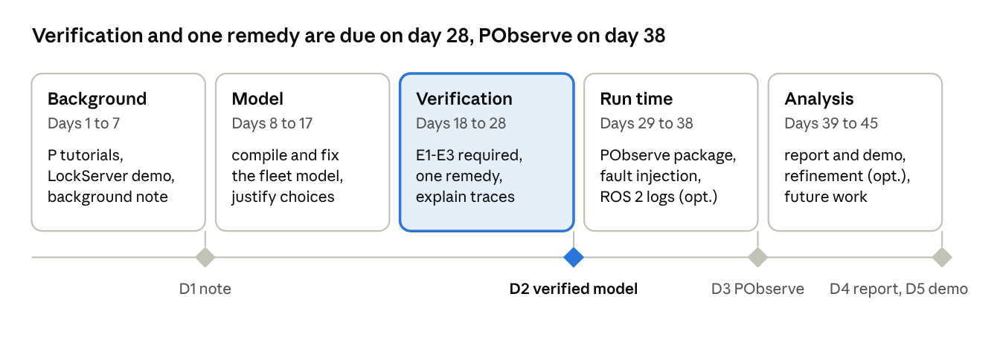

*Figure 18 · work plan: 5 phases, 45 days, 5 deliverables*

The verification phase constitutes the core of the project. If the modeling work is delayed, the optional ROS 2 instrumentation and the refinement stretch goal are to be omitted, not experiments E1–E3.

**Deliverables:**

| # | Deliverable | Due (day) | Content |
| --- | --- | --- | --- |
| D1 | Background note | 7 | 2–3 pages: MAS, norms, the unified view, P; the fleet placed in the grid, with justification |
| D2 | Verified model | 28 | compiling P project; results of E1–E3 and the Should experiments, with traces and explanations; one remedy evaluated |
| D3 | PObserve package | 38 | parser, JUnit tests (safety and fairness), runner, fault-injection logs, results |
| D4 | Final report | 45 | 8–12 pages in a workshop-paper format (e.g. EMAS, COINE or WESAAC) |
| D5 | Presentation and demo | 45 | 15 minutes: one checker counterexample and one PObserve fairness violation shown live |

## 9. Starter kit, setup and references

The `p-regulation` archive is given. This project uses `Common/`, `MobileRobots/` and `tools/`; `ManufacturingCell/` contains a simpler, centralized variant that serves as a reference.

| Path | Content | Status |
| --- | --- | --- |
| `Common/*.p` | shared model machines and monitors | draft, not yet compiled |
| `MobileRobots/PSrc`, `PSpec`, `PTst` | robots, wiring, fairness monitor, test cases | draft, not yet compiled |
| `MobileRobots/pobserve/` | Gradle build, parser, JUnit tests, sample logs | parser compiled and run on the sample logs; JUnit not yet run |
| `MobileRobots/INSTRUCTIONS.md` | step-by-step commands for both parts | ready |
| `tools/simulate_logs.py` | generates two-phase / naive fleet logs and previews monitor results | tested |
| `tools/instrumentation/regulation_log.py` | logging helper for ROS 2 / Python | tested |

**Required environment:**

- .NET SDK 8.0, followed by `dotnet tool install --global P`;
- Java 17 or later;
- Gradle 8.x;
- Python 3;
- optionally, ROS 2 for the instrumentation stretch goal.

Alternatively, the Docker image `ghcr.io/p-org/p:latest` provides .NET, a JDK and the `p` command-line tool. The PObserve command-line interface is built once from the P repository (`Src/PObserve/PObserve`, `./gradlew build`).

**Getting started:**

```
cd MobileRobots
p compile
p check -tc tcFleetNaive -s 10000
p check -tc tcFleetSanctionFairness -s 10000
cd pobserve && gradle wrapper && ./gradlew build uberjar && ./run_pobserve.sh
```

### References

Core:

- E. Yan, L. G. Nardin, O. Boissier, J. S. Sichman. *A Unified View on Regulation Management in Multi-Agent Systems.* COINE workshop, 2025. [HAL](https://hal-emse.ccsd.cnrs.fr/emse-05162306v1)
- E. Yan, L. G. Nardin, O. Boissier, J. S. Sichman. *A Regulation Adaptation Model for Multi-Agent Systems.* ECAI 2025, doi:10.3233/FAIA251245. [HAL](https://hal-lara.archives-ouvertes.fr/ISCOD-ENSMSE/hal-05350751v1)
- E. Yan, L. G. Nardin, J. F. Hübner, O. Boissier, J. S. Sichman. *Perspectives on Regulation Adaptation in Multi-Agent Systems.* WESAAC 2025, doi:10.5753/wesaac.2025.37527. [SOL](https://sol.sbc.org.br/index.php/wesaac/article/view/37527)
- A. Desai et al. *P: Safe Asynchronous Event-Driven Programming.* PLDI 2013. [Microsoft Research](https://www.microsoft.com/en-us/research/publication/p-safe-asynchronous-event-driven-programming-2/)
- A. Desai. *Modular and Safe Event-Driven Programming.* PhD thesis, UC Berkeley, 2020 (ModP, Drona). [PDF](https://www2.eecs.berkeley.edu/Pubs/TechRpts/2020/EECS-2020-3.pdf)
- P language documentation and PObserve guides. [p-org.github.io/P](https://p-org.github.io/P/)
- M. Brooker, A. Desai. *Systems Correctness Practices at AWS.* ACM Queue / CACM. [ACM Queue](https://queue.acm.org/detail.cfm?id=3712057)

P in robotics:

- A. Desai et al. *SOTER: A Runtime Assurance Framework for Programming Safe Robotics Systems.* DSN 2019. [arXiv](https://arxiv.org/pdf/1808.07921)
- S. Shivakumar et al. *SOTER on ROS: A Run-Time Assurance Framework on the Robot Operating System.* RV 2020, doi:10.1007/978-3-030-60508-7\_10. [eScholarship](https://escholarship.org/uc/item/5r78g42p)

Norms and verification:

- N. Alechina, N. Bulling, M. Dastani, B. Logan. *Practical run-time norm enforcement with bounded lookahead.* AAMAS 2015. [repository](https://nottingham-repository.worktribe.com/output/752739)
- L. Dennis et al. *Model Checking Normative Agent Organisations.* [PDF](https://personalpages.manchester.ac.uk/staff/louise.dennis/pubs/climaX.pdf)
- L. Gasparini et al. *CÒIR: Verifying normative specifications of complex systems.* COIN 2015, LNCS 9628. [record](https://abdn.elsevierpure.com/en/publications/c%C3%B2ir-verifying-normative-specifications-of-complex-systems)
- M. Dastani, S. Sardina, V. Yazdanpanah. *Norm Enforcement as Supervisory Control.* PRIMA 2017. [record](https://research.utwente.nl/en/publications/norm-enforcement-as-supervisory-control/)
- D. Dell'Anna, M. Dastani, F. Dalpiaz. *Runtime Revision of Sanctions in Normative MAS.* JAAMAS 34(2), 2020. [PDF](https://webspace.science.uu.nl/~dalpi001/papers/dell-dast-dalp-20-jaamas.pdf)
- *Norm specification and verification in multi-agent systems* (survey). IfCoLoG J. Logics and their Applications 5(2), 2018. [record](https://research.ou.nl/en/publications/norm-specification-and-verification-in-multi-agent-systems/)

Deontic and temporal logic:

- A. R. Anderson. [A reduction of deontic logic to alethic modal logic](https://doi.org/10.1093/mind/LXVII.265.100). *Mind* 67(265):100–103, 1958.
- J.-J. Ch. Meyer. [A different approach to deontic logic: deontic logic viewed as a variant of dynamic logic](https://doi.org/10.1305/ndjfl/1093637776). *Notre Dame Journal of Formal Logic* 29(1):109–136, 1988.
- P. McNamara and F. Van De Putte. [Deontic logic](https://plato.stanford.edu/entries/logic-deontic/). *Stanford Encyclopedia of Philosophy*.

Textbooks and background (from the field's standard literature; locate the current editions):

- M. Wooldridge. *An Introduction to MultiAgent Systems.* Wiley, 2nd ed. 2009.
- O. Boissier, R. H. Bordini, J. F. Hübner, A. Ricci. *Multi-Agent Oriented Programming: Programming Multi-Agent Systems Using JaCaMo.* MIT Press, 2020.
- G. Boella, L. van der Torre, H. Verhagen. *Introduction to normative multiagent systems.* Computational & Mathematical Organization Theory, 2006.
